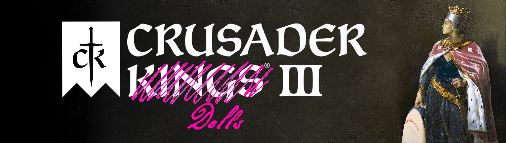

<a id="readme-top"></a>

<!-- PROJECT SHIELDS -->
<div align="center">


</div>

<!-- PROJECT LOGO -->
<br />
<div align="center">
  

  <h3 align="center">Crusader Dolls</h3>
  <p align="center">
    Six trans-women-centred faiths for Crusader Kings III.
    <br />
    <a href="#playtesters-wanted"><strong>Help playtest »</strong></a>
    <br />
    <br />
    <a href="https://github.com/PersephoneKarnstein/Transing-CK3/issues/new?labels=bug">Report a bug</a>
    ·
    <a href="https://github.com/PersephoneKarnstein/Transing-CK3/issues/new?labels=enhancement">Suggest a feature</a>
  </p>
</div>

<!-- TABLE OF CONTENTS -->
<details>
  <summary>Table of contents</summary>
  <ol>
    <li><a href="#about-the-project">About the project</a></li>
    <li><a href="#playtesters-wanted">Playtesters wanted</a>
      <ul>
        <li><a href="#prerequisites">Prerequisites</a></li>
        <li><a href="#loading-the-mod-from-this-folder">Loading the mod from this folder</a></li>
        <li><a href="#what-to-test-and-how-to-report">What to test and how to report</a></li>
      </ul>
    </li>
    <li><a href="#adelphai-dorleyaiou-the-sisters-of-dorylaion">Adelphai Dorleyaiou: the Sisters of Dorylaion</a></li>
    <li><a href="#bædling-the-high-seat">Bædling: the High Seat</a></li>
    <li><a href="#yutai-dao">Yutai Dao</a></li>
    <li><a href="#ha-nehpakhot-the-women-who-were-turned">Ha-Nehpakhot: the women who were turned</a></li>
    <li><a href="#cūṭikkoṭutta-mālai">Cūṭikkoṭutta Mālai</a></li>
    <li><a href="#badenya-the-mothers-children">Badenya: the Mother's Children</a></li>
    <li><a href="#shared-mechanics">Shared mechanics</a></li>
    <li><a href="#roadmap">Roadmap</a></li>
    <li><a href="#contributing">Contributing</a></li>
    <li><a href="#license">License</a></li>
    <li><a href="#acknowledgments">Acknowledgments</a></li>
    <li><a href="#bibliography">Bibliography</a></li>
  </ol>
</details>

## About the project

*Crusader Dolls* adds six faiths built around trans women to Crusader Kings III. (The repository is *Transing-CK3*; the mod is *Crusader Dolls* in the launcher; the Byzantine faith is *Adelphai Dorleyaiou*.) Each is grounded in a different historical setting and plays differently. Their tenets come from contemporary transfeminist writing: baedelism, third-wave transfeminism and transgender Marxism. A history pass then gives each a veneer of plausibility in its own place and period.

<p align="center">
  
  <br><em>The Crusader Dolls bookmark at 867.</em>
</p>

The six faiths answer the same three questions in different ways:

| Faith | How one becomes a daughter | How the line continues | How it meets the world | Home |
|---|---|---|---|---|
| **Adelphai Dorleyaiou** | The knife, as a sacrament with a sponsor | A founding charter passes land to adopted daughters | Refuge, intake and church politics | Dorylaion, Phrygia |
| **Bædling** | Seiðr: a völva goes into trance for the seeker | The hall's fostered, sworn and adopted daughters | Outlawry, raiding and insult duels | Gotland |
| **Yutai Dao** (the Way of the Jade Embryo) | Ten months' inner gestation of one's own body | Adopted heirs, and temple societies that hold property in common | Palace factions against the scholar-officials | Dunhuang, at the Mogao caves |
| **Ha-Nehpakhot** | The Turning: a prayer said aloud at Purim | The women of the lamp, and the three women's commandments | The street's licence or its shunning; patronage by translating or medicine | The Jewish street of Arles |
| **Cūṭikkoṭutta Mālai** (the Worn Garland) | The pāvai vow, kept through Mārkaḻi with companions; the staff and a name | A share on the temple street, recorded in stone | Temple endowments; orthodox pandits | The temple street of Kanchipuram |
| **Badenya** | A smith's bargain, a woman's claim, and a jeli's word that cools | Through a sister or daughter; the House buries its own | Praise and satire; the smiths' power; naming feasts | Kirina, in Mali |

What the mod is not:

- **No antagonist.** It does not add a hostile "anti-trans" nation or stage an allegorical clash of superpowers. It adds the faiths, and vanilla Christendom, the Caliphate and the Tang court react as they would.
- **Not trans men.** Trans-masculine content is out of scope. Someone else is very welcome to make it.
- **Vanilla castration still works as before.** Castrating someone with the base game's interaction does not turn them into a daughter.

> [!NOTE]
> **Content note.** The mod deals with castration, with a penal path that transitions violent prisoners (the "Dorley precedent", after Alyson Greaves's *Welcome to Dorley Hall*), and with the transmisogyny of medieval law and custom. Event text is written without gore, but the subject matter is there.

> [!IMPORTANT]  
> **These faiths are fiction.** All six are invented for a game. Their places, institutions and texts are drawn from historical scholarship, and the bibliography below lists it, but no *known* historical people held these beliefs. Some, like the Byzantine Sisters' heresy, sit close enough to the record that someone might once have believed something like them, but we cannot know that, and the mod does not claim it. Nothing here is a claim about anyone's real ancestry. The mod does not present any living community, such as hijra, khwaja sira, bissu or two-spirit people, as one of its faiths or as a forerunner of a modern movement. Where a faith in the game claims a historical figure or a past people as its own, that is the faith speaking in character, not the mod making a historical argument.

<p align="right">(<a href="#readme-top">back to top</a>)</p>

## Playtesters wanted

The mod is in alpha. Most of it has never run in a real campaign, and we need people to play it and tell us what breaks. You don't need any modding experience.

> **Playtesters: start with the [test guide](docs/TO-TEST.md).** It lists specific scenarios to set up, from a five-minute smoke test to long observer runs, with console helpers to skip the waiting, what you should see, and exactly what to send back. Pick any scenario; partial results and "it worked" are both useful.

### Prerequisites

- **Crusader Kings III 1.20.x.** The mod is written against 1.20.1.
- **DLC.** *Roads to Power* is required: the faiths often end up landless, and some start that way. We test with all DLC enabled; reports from players with fewer DLC are especially useful.
- **A new game.** The faiths are placed in the world at game start, so an existing save will not have them.

### Loading the mod from this folder

1. **Get the files.** Clone the repository, or download it as a ZIP from the green *Code* button and unzip it anywhere.
   ```sh
   git clone https://github.com/PersephoneKarnstein/Transing-CK3.git
   ```
2. **Find your mod folder.**

   | OS | Mod folder |
   |---|---|
   | Windows | `%USERPROFILE%\Documents\Paradox Interactive\Crusader Kings III\mod` |
   | macOS | `~/Documents/Paradox Interactive/Crusader Kings III/mod` |
   | Linux | `~/.local/share/Paradox Interactive/Crusader Kings III/mod` |

3. **Create a launcher file there.** Copy `descriptor.mod` from the repository into the mod folder and rename it `transing_ck3.mod`. Then add one line at the end giving the full path to the folder you cloned or unzipped. Use forward slashes, even on Windows.
   ```
   path="C:/Users/you/Documents/Transing-CK3"
   ```
4. **Enable it.** Open the Paradox launcher, go to *Playsets*, add **Crusader Dolls** to a playset, and make that playset active.
5. **Start a new game.** At 867, the **Crusader Dolls** bookmark lists a head of each faith: Theia Beatrike at Dorylaion, Steinunn of Gotland, Huijing of Dunhuang, Cantirâdêvi of Candragiri, Djeneba of Kirina, and Bonadonna, an elder of the women of the lamp, who keeps a landless scholars' camp at Arles (Roads to Power). In the Ruler Designer you can choose the Kybeline culture and any of the six faiths. You can also convert to one in a normal game.

To update later, pull or re-download into the same folder. The launcher file does not need to change.

### What to test and how to report

Good first tests:

- **Ruler Designer.** Do all six faiths and the Kybeline culture appear?
- **The six rites.** Play a Marked woman (the game still codes her as male) and take each faith's decision: *Take the Knife*, *Ask a Völva to Sit for Me*, *Gestate the Jade Embryo*, *Keep the Fourteenth of Adar* (February or March only), *Keep the Pāvai Vow* (December or January only) and *Go to the Smith*.
- **Re-embodiment.** After a rite, do your titles, marriage, children, adoptive parents and skills carry over?
- **Adoption.** Try *Take as Daughter* on a courtier, a ward and a guest.
- **Arrivals and Houses.** Found a Sisters' House. Over a long reign, do Marked travellers, cast-out women and friends of the House arrive? Does the House choose an Elder Sister, and split when it is strained? Give the county to a ruler of another faith and see whether they close it.
- **Declare Before Witnesses** and **The Sisters Choose** (an elective succession law): does the declared name survive the rite, and does the election pick sensible heirs?

When something breaks, [open an issue](https://github.com/PersephoneKarnstein/Transing-CK3/issues/new?labels=bug) and include:

- **What you did** and what you expected to happen.
- **Your error log.** It is `error.log` in the `logs` folder next to your mod folder.
- **A save**, if you can attach one.

**[docs/TO-TEST.md](docs/TO-TEST.md) lists specific scenarios to set up, with what to expect and what to send.** The game's console can run test scripts from `tools/run/`. Copy them into the `run` folder next to your mod folder, launch the game with `-debug_mode`, open the console with `~`, and type, for example, `run tm_census.txt`.

<p align="right">(<a href="#readme-top">back to top</a>)</p>

## Adelphai Dorleyaiou: the Sisters of Dorylaion

*Adelphai Dorleyaiou*, "the Sisters of Dorylaion." A Christian heresy in Byzantine Anatolia, centred on the house at Dorylaion. The name is a pun on Dorley Hall.

The Sisters are nostalgic for a sect almost nobody remembers: the Mother's galli of Phrygia, whom they call *gallae*. They say the house at Pessinus never closed, and they remember it kinder than it was; Pessinus in fact belonged to priests titled Attis who passed the office from father to son. In their own voice they claim a line from Pessinus through the prophetesses of Pepouza, the women-led Montanist church of Phrygia, to Dorylaion. What they refuse is what the Byzantine court offers instead. "The court calls its eunuchs angels," they say, "and buys them as boys." The Emperor's law counts three kinds of people: men, women and eunuchs. The Sisters hold that one who takes the knife rises a daughter, not a third thing.

- **The gate: the knife.** *Take the Knife* takes two days, as the Mother's festival did: blood and mourning on the Day of Blood (24 March), then the knife, the knifer's question and a new name at the Hilaria, the festival of joy. Each faith picks one of three houses for who may be cut:
  - **Grandmother's House:** any captive, man or boy, in the old cruel way. She called them eunuchs, not daughters: unmanning them was the point.
  - **Aunt Bea's House:** its cells take only grown men proven violent, each under a sponsor who walked the same road, with a washout path for those who will not change. A Marked or declared woman held prisoner is never put in the cells: the House welcomes her, frees her, and offers her the knife as her own choice. It holds that every woman who leaves its cells is a woman, claims no law for it, and admits that it keeps cells.
  - **Gift Alone:** only grown women who ask. "Even the Mother of God was asked." "A gift you cannot refuse is not a gift." The strongest doctrine over a long game.
- **The line.** Daughters choose their heirs rather than breed them. A woman of the House can foster a daughter, who belongs but does not inherit, or take her as a daughter with the written clause that makes her an heir. Each House has a Protectress from the founder's female line, as the convent charters passed protection of a convent "in perpetuity", and its sisters name three for Elder Sister and let the lot decide.
- **The court.** Dukes and above can appoint daughters of the knife and eunuchs to the offices the Byzantine court reserved for its eunuchs: Parakoimomene, Protovestiaria and Papias. Any woman can be Praiposita of the empress's chamber.
- **The Women's Chamber.** Under the emperor of the Romans, or any Byzantine throne of administrative government, the empress's chamber may write to a daughter of the faith anywhere and offer her a post at court. Its clerks would write her in their eunuchs' column; a notary of the empress's may write her among the women instead. The chamber pulls against the Patriarch's party, and a woman on the throne or in the regency draws it up. While it has the throne's ear the laws against heretics are not read; with its standing a daughter can win a House a chrysobull or ask the throne for an estate, which a later throne, as Basil II did in 996, may annul. When the Patriarch has the throne's ear, the synod writes.
- **The world.** The *Rescue the Daughters* war takes a neighbouring county where daughters of the faith live under a lord of another faith, or whose lord holds one prisoner. The women freed choose whether to join the attacker's court or go home. A bishop may preach that the Sisters are "Cybele in Christian clothes", and under a lord of another Christian faith the old laws against heretics climb rung by rung, faster after the Komnenian turn of 1081: the books burned, the assemblies banned, and, under a Byzantine lord, the wills voided.
- **Tenets.** Day of Blood, Daughters Chosen Not Born, and Unbending Sisterhood.
- **Head of faith.** The Mother of Mothers, Theia Beatrike, an elder daughter seated at Dorylaion, with up to seven Companions, as the Montanist prophetesses had theirs.
- **The Emperor's road.** In 949 the Mother of Mothers can ransom the four child eunuchs Liudprand gave the Emperor, each knife House in its own way. When the Emperor goes to war his army may halt at Dorylaion, and his chamber may ask for a daughter, whom it would count a eunuch.
- **The foremothers.** The Sisters keep five saints of their own, women who died before 867: *Stephania the First Mother*, who took the knife by her own will and founded the House at Dorylaion; *Bethania the Bookbearer*, who carried the House's books out of Dorylaion and died in a governor's prison at Ankyra rather than name a House; *Diana of Kyzikos*, who founded the first daughter House and took in widows and barren wives; *Christina the Physician*, who taught the Houses to keep the knife clean; and *Philippa Who Walked Beside*, who walked the novice years beside many daughters, Theia Beatrike among them. At the 867 start each lies at one of the faith's holy places, as vanilla's saints do. They are inventions, named after the women of *Welcome to Dorley Hall*. The Church's monk-saints who lived as men (Marinos, Euphrosyne, Pelagia) are not claimed: the Sisters call them the Church's double standard.
- **Holy sites.** Dorylaion and Constantinople, Kyzikos, Ankyra, and ruined Pepouza.
- **The Galenic wing.** The main rite is Aristotelian: the cut body changes into the female condition. From 886 a ruler of the faith may found the Galenic Rite, the rite that agrees with the Emperor: Leo VI's law counts men, women and eunuchs, and the Galenic Sisters call the cut some third thing. It buys peace with Christian lieges and costs piety and the daughters' names in the register. Its book, from 1107, is Theophylact of Ochrid's *In Defence of Eunuchs*. The Aristotelians call it "the old cage with a new name"; a ruler may come home to the main rite. Its founder's students take the rite with her, and in later years the school wins some sisters over, more readily where its sisters already sit at court or hold power.
- **The Tower on the Condition.** A sister at the court of a Christian lord in the Byzantine world may ask him for an empty tower, on the condition that the Sisters rebuild it and keep it manned, as monks were granted towers in the 14th century. If he grants it, a Sisters' House stands there by his leave. Five years manned and the tower is theirs to keep; two years empty and he may take it back. A later lord finds a kept tower's grant harder to set aside, and men who robbed the road may come to keep its flocks.
- **From the record.** In November 867 Ignatios, cut at fourteen, returns as patriarch, and each House answers in its own way. Before 990 a merchant's train of captive boys passes on the road to Tarsus, and the Houses buy them free, free them and jail the merchant, or (Grandmother's House) take only the boys already cut; no child is cut on screen. From 1063 to 1078 a copy of a letter by Michael Psellos, who wrote of his own soul as feminine, reaches the Mother House, and each wing reads it its own way. In 1083 the Holy Mountain closes to eunuchs, and from 1120 a convent's eunuch steward, barred from the enclosure, may ask a House for work.

**Read more:** [the full overview of Adelphai Dorleyaiou](docs/faiths/adelphai-dorleyaiou.md), with its history, sources and mechanics, cited to the page.

<p align="right">(<a href="#readme-top">back to top</a>)</p>

## Bædling: the High Seat

*Working name.* A Germanic pagan faith of Scandinavia and Anglo-Saxon England. It takes its name from *bædling*, a word of uncertain meaning that the Old English Canons of Theodore set apart from "other men" in their canons on sex between men; one glossary puts it beside *effeminati*, and the glossaries also keep *bæddel*. It joins that word to *seiðr* and *ergi*.

In the north the sanctioned crossing ran toward manhood. Anyone the law counted a man who went the other way was called *ragr*, yet Icelandic law outlawed not the one so called but whoever said the word, and the one so named could kill the speaker. The Bædlings keep the other road. In the north the law let vagrants be castrated without penalty, and men unmanned their enemies; it was never a rite, so this faith does not use the knife.

- **The gate: seiðr.** *Ask a Völva to Sit for Me* is a three-day rite, like a wedding, built on the seeress in *Eiríks saga rauða*:
  - **The völva comes.** She is given the high seat and a feast.
  - **The warding songs.** Someone must sing the *varðlokkur*, which girls learn from their foster-mothers. A woman of the faith can teach them to a daughter or ward.
  - **The platform.** The völva goes up into trance while the seeker waits below.
  - **The odds.** The faith holds that the völva sees a daughter rather than makes one, and the odds turn on whether the song holds, not on the seeker's merit; it may fail until next winter. The rite follows the seeress in *Eiríks saga rauða*, which scholars think was largely invented to honour her host; the warding songs are the part most likely to be old. Völur also travel the halls in winter and can be asked to sit for anyone at court.
- **The declaration.** A new daughter declares herself before the thing, perhaps with a name fastened by a gift or the woman's form of her own. When someone shouts *ragr*, she can answer in verse, with steel, by owning seiðr as women's art, with "*ragr* is said of men", or not at all.
- **The line.** The hall's daughters are fostered, sworn and adopted. Two may bind themselves as sisters by the old oath.
- **The world.** A martial faith. The skalds fill Valhöll with dead men; the Bædlings say the Allfather's true host has none, and point to the shield-maidens at Brávellir. English courts call valkyries witches. The hall raids to bring its daughters home, and its clergy fight. The faith's devil is Níðhöggr, the malice-striker: its enemy is *níð* itself, the slander shouted at the thing.
- **Tenets.** Seiðr Unmans, Óðinn's Host, and Daughters of the Hall.
- **The flyting.** Three rounds of charge and answer: a true charge wins, a false one rebounds, and against *ragr* the strongest answer is to own the word. Stakes double at the June thing, and a lady of the hall can end it with the cup.
- **Outlawry.** From 1100, under Christian Norse lords, a Bædling may be sued at law: for sorcery by the church, or under the law of dress. Six housewives may swear for her. Otherwise she pays the life-ring and goes abroad for three winters, or refuses and is outlawed in full. A full outlaw who can fight leads a band of her own. A settlement, service in the realm's war, or land of her own ends it.
- **The law changes with the North.** In Iceland the one who hired a seeress answers for her, and twelve jurors may clear her client; in Norway the seeress answers, and six housewives may clear her. From 1300 a bishop may offer penance and seven years on the pilgrim roads instead, under a condition that does not end. Where the law has become capital (Norway from 1300, Scania 1328, Sweden 1350), a woman who comes before a court again is handed to the lord's keeping. Trials stay rare. A fortnight after a sentence comes the confiscation court, and if it cannot sit, the sentence lapses. An outlaw in full may ride from hall to hall for pledges to buy a settlement, and a House that keeps her bears the strain and the accuser's summons.
- **The feud, finished.** A requital on someone of higher rank overbalances the Account, one on someone lower settles nothing. A house that owes may grant the other Self-Judgment: a modest award, a heavy one the neighbours call uneven, or none at all. A settlement can be sealed by fostering a child of the other hall ("The one who fosters is the lesser. The hall is glad to be lesser."). A Norse lord who wrongs a woman ruler may refuse to keep an Account with women, and her next blow against his house is answered with honour. When an outlaw of the faith is killed, the law counts no wrong, but her sworn sister may take up a private Account. Under lords not of the six faiths, a woman's suit must be carried by a man.
- **Lore.** Courtiers tell of the converting kings, and of a pagan king who burned eighty men he called *seiðmenn*; news comes from the islands of burnings on a bishop's sentence; a rival says a Norse lord keeps *seiðmenn*; a woman who knows the warding songs can weave a shirt no blade will bite; each holy site, and Gotland, has its story. From 1350 a daughter of any of the six faiths in England may learn the needle trade at an older woman's bench and take a woman's name there.
- **The band.** A landless Bædling band can answer the hall's call home (see *Bands come home* under [Shared mechanics](#shared-mechanics)).
- **Open Ports.** A lord at war, of any faith, may open his ports to anyone who will harm his enemy at their own risk, as the Mecklenburg lords did after 1389. A Bædling band near his coast can take the letters (vanilla's join-war contract) and, while the war lasts, may seize an island seat. Peace ends the licence. A band that still holds an island after that may draw a great power's fleet.
- **The Island Changes Hands.** When Gotland passes to a lord of another faith by conquest or grant, the faith's people there choose: keep quiet in this land, raise the island's levy as the farmers did in 1361, or go to the ships.
- **The Peace of the Island.** Gotland's ruler, of any faith, may have the island's peoples swear peace, as Gotland and German traders did in 1161: one town, one council, and less ill will between them.
- **Holy sites.** Uppsala, Trondheim, York and Kyiv. Kyiv sits on the Varangian road south toward Dorylaion.

**Read more:** [the full overview of Bædling](docs/faiths/baedling.md), with its history, sources and mechanics, cited to the page.

<p align="right">(<a href="#readme-top">back to top</a>)</p>

## Yutai Dao

*Working name.* *Yutai Dao* (玉胎道) is "the Way of the Jade Embryo", in pinyin as the game writes its Chinese faiths (Zhengyi, Shangqing). *Yutai* is the faith's own coinage: inner alchemy speaks of a holy embryo (*shengtai* 聖胎) or an embryo of the Dao (*daotai* 道胎), never a jade one. A Daoist faith of Tang China, seated at Dunhuang beneath the Mogao caves, where Daoist priestesses were ordained in the eighth century. In 867 the town's Daoist abbeys stand dark after Tibetan rule; relighting the Shenquan Abbey is the faith's first project.

Daoist inner alchemy teaches that an adept nurtures a holy embryo for ten months until it is born from her and becomes her true self. In the faith's own telling, Lord Lao once took the shape of Mother Li and sheltered in his own womb, and the masters say a man must reach a state of pregnancy before he becomes pure yang. The Way stops there, at the mother: its adepts are born as themselves. The palace counts the cut among its men and would count these women among them too. The Way answers with Confucius's rectification of names. A daughter named before witnesses is a daughter, and any eunuch who seeks the same is received as a sister. Its high god is the Queen Mother of the West, under whom the Tang master Du Guangting ranked every woman who attains the Way.

- **The gate: the jade embryo.** In *Gestate the Jade Embryo*, a guarantor vouches for the house that will shelter the adept, and a nüguan (a Daoist priestess) asks her "Will you ever repent?" Ten months follow:
  - **The first bathing** (month 3): a censor checking the clergy roll threatens to strike her off as a private nun.
  - **The White Tiger** (month 6): her family writes to summon her home. She can refuse ("Not yet! Don't rush me!") or go home to nurse her parents first.
  - **Birth from the crown** (month 10), and a name before witnesses.
  A physician may call it a "ghost fetus" and bring a purge. Nothing she has done is ever lost.
- **The line.** Under Song law a daughter, born or adopted, keeps a sonless house; the magistrate takes only what a house with no daughter leaves. The faith's temple and burial societies pay dues at every birth and death, keep a righteous store that lends at interest, and petition the throne for a name-panel that protects their Houses from confiscation. Waves of confiscation grow after the Yuan conquest.
- **The world.** A courtly faith of intrigue and stewardship. Prodigies are reported in the prefectures, and a king of the Way can ordain a woman by special edict, as the Song court once ordained a bearded woman. Buddhist neighbours read a daughter as a man reborn a woman for an old sin. A palace faction contends with the scholar-officials.
- **Tenets.** The Jade Embryo, Rectified Names, and Temple Societies.
- **The palace offices.** Under a celestial or meritocratic throne the eunuchs' side of the court may offer a daughter a post: power, at the cost of her Houses' name-panels, a censor's memorial, and the purge of 903. With the seal she can work the inner offices against the scholar-officials, the Northern Office against the Southern. She can adopt followers as the Tang eunuch houses did, register an heir under Song law, win a Shence commander before 903, sit with the ministers, or spend the palace's standing on name-panels and licences for the society. When the scholar-officials have the throne's ear, their memorials come faster. At a celestial court a censor of the Way may hold them on her desk, or send them up.
- **Neighbours from the west.** At Dunhuang the Sogdian families of the old merchant towns sit in the same street societies as the House. A year-end circular may call the sisters to a banquet at the Cao family's inn, and the House may open its own society to the neighbours' daughters, who keep their own faith. A woman of a merchant family, stranded far from home with no reply to her letters, may come to the House for a camel and a place in a caravan west.
- **Hide the Name.** Since An Lushan's revolt, families from the west have hidden their origins. A member of the Way of Sogdian heritage, or a daughter at a hostile court, may write a new surname or another birthplace in the register and keep quiet in this land. She hides where she came from, never what she is.
- **Holy sites.** The Mogao caves, Mount Longhu, Mount Qingcheng and the Southern Marchmount (Mount Heng in Hunan), the holy women's mountain.

**Read more:** [the full overview of Yutai Dao](docs/faiths/yutai-dao.md), with its history, sources and mechanics, cited to the page.

<p align="right">(<a href="#readme-top">back to top</a>)</p>

## Ha-Nehpakhot: the women who were turned

*Working name.* A small current inside Judaism, kept by the women of the lamp: women householders of the Jewish street of Arles who sit together in the women's synagogue, below the men's, and keep the alms of the synagogue lamp. (No medieval women-only confraternity is attested; Arles had a lamp alms, and in 1401 its council called five women to sit, "because what concerns all must be approved by all".) It holds no land at the start: it lives under other lords, as the Jews of Arles lived under their archbishop. At 867 its elder, Bonadonna, keeps a landless camp of scholars and physicians, the *Women of the Lamp*, and stands on the bookmark; its families stay in the Jewish street under the count of Venaissin.

The rabbis divide the eunuch made "by the hands of heaven" from the one made "by human hands", and the made eunuch stays, in law, a man. No rabbinic text lets anyone pass from male to female, and a Jewish court would read a daughter of the knife as a man made a eunuch. The Talmud does tell how Leah prayed and the child in her womb was turned into a daughter, Dinah, though it adds that one does not cite miracles. In the winter of 1322–23 Kalonymus ben Kalonymus, who was born at Arles and worked there, wrote the satire *Even Boḥan* (*The Touchstone*) in Catalonia. In it he asks God, perhaps in jest, "would that You turn me from male to female", and he describes young Jewish men putting on women's dress for Purim. The Nehpakhot take all of this at its word, in their own voice. They say only the hands of heaven turn, so the faith uses no knife.

- **The gate: the Turning.** *Keep the Fourteenth of Adar* can only be taken in Adar (February or March). It is a five-part rite:
  - **The scroll.** An elder reads Esther in the women's synagogue, and beside "it was turned about" she reads the other turnings: Abraham from the furnace, the staff, the sea, and Dinah.
  - **The revel.** From 1323 the young men put on the woman's dress for the joke, and the rabbis grumble and let it pass (permission comes only in the 16th century). She keeps it on when the joke is over. Before 1323 the custom is unattested, so she is the only one in the dress.
  - **The prayer.** The men thank God each morning that He did not make them women. She asks aloud for the reverse.
  - **The name**, on Shushan Purim. The women teach her their blessing, "who made me a woman" (in Provence, in their own tongue: *qui fis me fenna*). It is written down only after 1453, in Provençal women's prayer books; that it is older is the faith's claim. She takes a name from the scroll (Dinah, Esther, Sara) or a name of the street, as the Jewish women of Provence were called in the notaries' books (Rosa, Mairona, Bella, Regina, Blanca, Gratiosa, Bonadonna and others).
  - **Before the street's judges.** The dress has outlived Purim, and the street must judge: the worthies before 1215, then the three rectors of the archbishop's ordinance, the baylons from 1386 and the council with them from 1401; from 1401 the council at Arles includes women, and that helps her. She can answer with Dinah, text against text, and win her county a licence; lose and be shunned (*niddui*); cite the *Touchstone*; claim the house as its lady and accept the shunning; or put the dress away. In Christian lands a community could shun only by its lord's licence, so a lord who has taken her people under his protection refuses it, and the sentence falls. (In the Maghreb and the Sahel, see below.)
  - **The odds.** The Turning rests on learning, the elder's and her own, and on patience. Every Adar's unanswered prayer makes the next more likely, as Leah's was answered in its time. A seeker of another Jewish faith who is turned joins the sect.
- **The line.** Womanhood is what she keeps: the three women's commandments Kalonymus wished for (the days of separation, the portion of the dough, the Sabbath lamp). One whose days do not come keeps them as the *zekenah*, the old woman past them, keeps them. An elder can teach the prayer to one who will need it, and the women spin together by moonlight.
- **The world.** A learned, landless faith. A lord of any faith with a daughter of the Turning at court may commission a translation from Arabic, as Robert of Naples employed Kalonymus, and take her people under protection; or licence her as a *fisica*, a physician, as Provençal women physicians were licensed. Jewish lords are asked to rule whether what came forth male is male. Jewish characters think less of daughters of every faith; the Nehpakhot think more.
- **Tenets.** The Turning, The Three Lamps, and Legalism.
- **Family and door.** Her own kin may send her a prayer book with Rebecca's blessing, "my sister", or decline at no cost to her; in the Days of Awe she may give the prayer to the women at the door. The kahal keeps its children, as all six faiths now do: a guardian of another faith may teach them but not convert them.
- **The street.** The women spin together by moonlight, and she may tell them of Sarah. The talk may reach the worthies, and a good answer makes the street's next hearing easier. When she marries, her spouse may have a goldsmith make her an adornment. From 1260 a rival may take her to a Christian lord's bailiff: she pays the fine, asks a lord she has served to stand for her, or answers herself. From 1400 the town's young men may come into the Jewish street at Carnival for the *pelote*. From 1409 she may buy a seat below, in the women's synagogue, in her own name. From 1390 a daughter in Catalonia may take a Catalan name of the street.
- **No Service in the Prince's Wars.** A lord of another faith may give the Nehpakhot at his court terms: his wars are none of their concern unless they ask to ride with him, and they settle their own quarrels. In return one serves him as physician, interpreter or steward. No money passes either way. From 1229 an Orthodox lord's scribe knows such clauses from the prince of Smolensk's treaty with German merchants.
- **A household of the street.** A ruler of the sect, landed or not, may pay the road for a Jewish household (a man, his wife and their child) to settle at her court, once in ten years, as an Arles contract of 1422 paid a man to bring his wife and child from Barcelona. They keep their own faith; the kahal may take them in later.
- **After the fall.** When a lord who took a daughter's translations into his house dies, the street is afraid for a year, as Toledo's preachers read the fall of the Jewish courtiers in 1281 as God's anger: her hearing and prayer are harder there, unless she keeps her name indoors, answers the preachers, or goes to the women of the street. In the Crown of Aragon the bailiff is the *batlle*, and from 1270 the street's judges are the *berurim*.
- **The lord's licence.** Outside the Maghreb and the Sahel, a ruler of the sect may lift the street's ban on a daughter at her court, license it for one year only, or let the judges' ruling stand. Lifting it costs her with the other Jews at court.
- **In the Maghreb and the Sahel.** Under a Muslim lord the street's ban is its own: no lord licenses it, and its judges are the elders and the dayyan. The lord may send a case back to be heard again (trustworthy women come to hear her at home), lend his court to enforce the ban, forbid it if someone at his court speaks for her, or stay out of it. A ruler of the faith there may decree that neither party of the Jews bans the other. A daughter who serves a Muslim lord as physician (from 1075, as vizier) can speak for her people. Also: Maghrebi names, the Purim fires of Qayrawan, the Qayrawanese attire, Nissim's story with no ending, a refuge decision for the Almohad years (1146–1229) and the decorous hush. Refugees taken in keep their own faith: shelter is not conversion.
- **Holy sites.** Arles, Jerusalem (whose county holds Hebron and Leah's tomb), Narbonne, Montpellier, and Hamadan, the tomb of Esther and Mordecai.
- **What it leaves out.** The old charge that medieval Jews ran the slave and eunuch trade is a historiographic motif, not a finding (Phelan 2023), so no Jewish character in the mod trades in slaves or eunuchs. The faith is not seated in Khazaria, and the narrator never says the Talmud recognised "six genders": those are legal categories for bodies, mostly intersex ones, and only a character may claim them. Nor does it use any of the medieval Christian tropes about Jewish bodies (the "male menses", the bloody flux) or the accusations about Purim.

**Read more:** [the full overview of Ha-Nehpakhot](docs/faiths/ha-nehpakhot.md), with its history, sources and mechanics, cited to the page.

<p align="right">(<a href="#readme-top">back to top</a>)</p>

## Cūṭikkoṭutta Mālai

*Cūṭikkoṭutta Mālai* is "the garland worn and given": Āṇṭāḷ's father named her *cūṭikkoṭutta nācciyār*, "the lady who gave what she had worn" (Dehejia p. 8; Govindacharya pp. 46–47; Ramanujan p. 148 n. 5). In English the faith is the Worn Garland. In game it is spelled *Cūtikkotutta Mālai*: the interface font has no dotted letters.

*Working name.* A current of Tamil devotion inside Hinduism that crosses Śiva's temples and Viṣṇu's, seated on the temple street of Kanchipuram. The bride and the worn garland come from the Vaiṣṇava poets; the "daughter of God" and the women's song from Śiva's temples, whose inscriptions share one vocabulary with Viṣṇu's.

Tamil poets, men among them, sang to the god as girls in love from the seventh century; a Kannada Śaiva poet of the twelfth asked to be the devotees' bride, and a thirteenth-century commentator wrote that before God the devotee "loses his own male nature and will wear the dress of a woman". In period this was a rite or a reading. The Garland holds that it was a life. Its scripture is King Bhaṅgāśvana of the Mahābhārata, turned into a woman, who was offered her old body back and said, "I desire to remain a woman." Chola temples called their women "daughters of God" and gave them houses and shares on the temple street; no record shows anyone assigned male among them, so the Garland is a reconstruction, and says so.

- **The gate: the pāvai vow.** *Keep the Pāvai Vow* can only be taken in Mārkaḻi (December or January). It is a month-long vow kept with companions, the women of the court:
  - **The waking.** Before dawn she goes from door to door and wakes the girls of the street.
  - **The song.** The Śaiva *Tiruvempāvai*, which temple women paid to sing, or Āṇṭāḷ's *Tiruppāvai*. Cold dawns thin the circle.
  - **The garland.** She may wear the god's garland before it is offered, as Āṇṭāḷ did, and risk being seen.
  - **The dream** of the wedding: a sign, not the success. Āṇṭāḷ woke from the same dream.
  - **The staff and the name.** The old rite of Śiva's temples touched a staff to a girl's head and named her a daughter of God. What decides it is how many of the circle held to the end.
- **The line: a share on the temple street.** A Hindu lord may grant a daughter of the Garland at his court a house and a share on the temple street, written in her name, not his; from 1070 she may buy one herself. It pays a little gold each year while she lives in its county. From 1070 it passes to her eldest daughter of the Garland, born or taken; before that, or with no daughter, the women of the street choose who holds it. If she is away three years running, it goes to those who do the work.
- **A gift in her own name.** A daughter with gold of her own may light a lamp before the god, endow a feeding house that bears her name, or, from 1119, set up the Lady beside the god, which brings a share. From 1100 the Lady also brings the title *She of the Illustrious Staff*: pay the priests' fee and have it cut in stone, or let the eldest of the street lay the staff.
- **Other courts.** A Hindu lord's pandit may read the law books over the lord's own daughter: food and clothing only, an appointed daughter who stays his heir, or a share in her own name. A Jain monk may say his Order will not house her; under a Śvetāmbara lord the Order's own rule may admit her for her skill, and she can take the place on her terms or refuse it. At Shaiva courts from 1135 a reciter tells of the merchant's wife of Kāraikkāl, given the form she asked for; at Kannada courts from 1160 a singer brings Basavaṇṇa's sayings.
- **The market and the road.** A daughter with no land can give a lamp through the market assembly of her county, which keeps it burning in her name wherever she goes. A poor Hindu lord may settle a daughter in an emptied quarter of his capital, free of its dues, at half a share's pay for ten years. A band of the Garland in the south can take a contract to guard merchants' caravans to the coast. After three, the merchants' lord may offer the band a frontier county as a guild town. A guild town that joins a faction against its liege hears what happened at Valikandapuram.
- **The world.** A name in stone: gold given to the temple buys an inscription and lasting piety. Orthodox pandits answer with Ilā, the king turned woman who was turned back in every telling.
- **Tenets.** The Pāvai Vow, The Temple Street, and Bhakti.
- **The temple's deal.** As temple women did in the inscriptions of 1070–1300, a daughter may buy a hereditary honour with a gift: a verse to sing in Mārkaḻi, the flywhisk, or the first house. It passes to her eldest daughter.
- **Holy sites.** Kanchipuram, Srirangam, Thanjavur and Madurai.
- **What it leaves out.** No link to hijra communities; Āṇṭāḷ is venerated, never cast as founder or a trans figure; temple women are not "brides of God" (a 17th-century idea) or courtesans.

**Read more:** [the full overview of Cūṭikkoṭutta Mālai](docs/faiths/cutikkotutta-malai.md), with its history, sources and mechanics, cited to the page.

<p align="right">(<a href="#readme-top">back to top</a>)</p>

## Badenya: the Mother's Children

*Working name.* A Mande faith inside the West African religion, seated at Kirina in Mali. In Mande speech *badenya*, mother-childness, is the bond of those who share a mother; *fadenya*, father-childness, the rivalry of those who share a father. Badenya takes the first as its law. Its god names replace the vanilla religion's, which come from Marcel Griaule's Dogon studies, since discredited.

In the Sunjata tradition a woman named Tenenba claimed a hero she had not borne: "I have given birth to a child without getting pregnant." Twentieth-century Bamana sculptors told of a djinn that asks a life of the household, and of a sculptor who gave up their own manhood instead and was called, in the tale, less than a man after. Badenya says she is not less. Ibn Baṭṭūṭa saw bird-masked bards before the king of Mali in 1352, and the line passed through a sister's son at Ghana and Walata. No source shows anyone assigned male becoming a woman here before 1453; the faith is built on institutions that are attested, and says so.

- **The gate: the crossing.** *Go to the Smith*. She is "hot", as the Mande say of one between states, until the word cools her:
  - **The smith's bargain.** The djinn asks a life of her house; she gives instead the manhood she was assigned. The djinn returns once, a year later, for a second price.
  - **My mother's child.** A woman of her family or the court must claim her, and she pays bracelets for her crossing. If no woman will, she waits.
  - **The word that cools.** A jeli speaks her name before the lord, her claiming mother's name before it. Paid well, it is praise; paid badly, it may be a joke the court remembers.
- **The line.** Through a sister or a daughter. When a daughter dies, her blood kin may come for her body and her birth name; the House would bury her under her own.
- **The world.** Naming feasts: a daughter first serves at others', then hosts her own while a jeli speaks for her. This texture comes from contemporary West African studies and is marked as reconstruction; the faith borrows roles, never the identity of any living community.
- **Tenets.** The Crossing, Mother's Children, and Ancestor Worship.
- **The New Roof.** Every seventh dry season a court of the faith re-roofs its house and gathers the daughters who crossed since the last roof into a named age-set.
- **At court.** When a ruler of the faith dies, the heir answers the sister's line: pay the sister's share, honour it in words, or refuse, and the sister's child gains a claim. A new ruler's realm is hot until a jelimuso's cool word settles it. The court's jelimuso sings the ruler's line, mother's name first, and must be paid before everyone; at a child's naming one may come uninvited. From 1352 a ruler may name her spouse, a sister, her mother or her claiming mother associate in rule, and her name is said with the ruler's at the feast.
- **Holy sites.** Kirina, Niani, Awkar, Walata and Do.
- **What it leaves out.** No Ṣàngó priests, *'yan daudu*, *góor-jigéen*, *woubi* or *sasso* are mapped onto it; no Griaule cosmology; none of the Kangaba sanctuary's rites.

**Read more:** [the full overview of Badenya](docs/faiths/badenya.md), with its history, sources and mechanics, cited to the page.

<p align="right">(<a href="#readme-top">back to top</a>)</p>

## Shared mechanics

- **Marked by the Mother.** A rare trait for trans women before any rite, including some who have not yet said so; the game still codes them as male. You can filter for it in the Character Finder to find people to recruit and adopt.
- **Re-embodiment.** After a rite, the daughter continues in a female body with the same face. Her titles, marriage, children, parents, adoptive parents, skills and lifestyle experience carry over. Re-embodied daughters are infertile. A game rule turns this off.
- **Take as Daughter.** Each faith's own adoption. Unlike vanilla adoption it accepts adults, and it ignores the rules that block children with landed relatives.
- **Declare Before Witnesses.** A Marked sister can take a daughter's name before any rite. The rite changes her body, not her name, and a failed or delayed rite never takes the name back.
- **Sisters' Houses.** A ruler can found a House in her capital county. It belongs to the county, not her family: a later ruler of another faith may let it stand or close it, and closing sends the sisters on to another House rather than deleting them. Each House chooses its own Elder Sister every five years, a daughter or Marked sister when one is eligible, frays under strain (too few hands, war levies), and splits to found a daughter House next door. Houses draw arrivals and can send newcomers to your court. Cis women of the faith are sisters too, and men of the faith can stay as friends of the House.
- **The Sisters Choose.** An elective succession law: the ruler, the faith's clergy and its vassals choose an heir from among the ruler's born and adopted children, the women and Marked sisters of the faith on the council, and the faithful vassals; a daughter or Marked sister weighs most. AI rulers of the faiths take it up when a daughter stands among those candidates.
- **The faith's own office.** Each faith has an office that only its daughters hold: the Companions of the Mothers at the Mother House, the Völva of the Hall, the Head of the Society, the Elder of the Lamp, the Eldest of the Street and the Mother of the Roof. Any ruler of the faith may appoint one; the AI does whenever a daughter is at court. She keeps the faith's gate at that court (the völva sings the seiðr, the elder reads the scroll, the eldest lays the staff, the Mother of the Roof claims the new woman, the society stands by the adept), the call reaches the court a little more readily, and its Houses bear their strain more easily. When the Mother of Mothers grows old or ill, her Companions put their weight behind a daughter to follow her.
- **Jewish and Indic neighbours.** Jewish courts think less of a daughter of any faith ("what came forth male is male"), and a Jewish lord may be asked to rule on one at court; the Nehpakhot cancel it. Buddhist, Hindu and Jain courts read a daughter of the knife as a castrated man and think much less of her, and a daughter of the other gates as a man become a woman, which they mind less.
- **Islamic neighbours.** Islamic courts value a daughter as a trusted servant and think less of her as a ruler: their jesters may mock a daughter who rules, while an Islamic lord may come to trust one in his household.
- **Under a lord's word.** A daughter of any of the six faiths at a Muslim court may put herself under the lord's word. A lord who gives it keeps the code: he takes her into his court, will not give her up when a liege or neighbour demands her, and his household does not offer her a place "without desire". In Iran and Iraq before 1056 the town's *fityan* may swear him in, and the text speaks of *futuwwa*; elsewhere it is a free man's word. The protection is for honour and service, never for gold.
- **The call.** Each year a Marked character of another faith may join the nearest of the six: Byzantium and Anatolia to Adelphai Dorleyaiou, the North and the Baltic to the Bædlings, China and the Tarim to Yutai Dao, the Jewish faiths to Ha-Nehpakhot, the Deccan and Tamil country to the Worn Garland, and West Africa to Badenya. A Sisters' House nearby, or a daughter at court, makes it likelier. Courtiers who are Marked, eunuchs or declared sisters may begin their faith's rite on their own, and a ruler with no heir of her faith looks for a daughter to take.
- **Arrivals.** Each year a Marked traveller, a woman turned out for bearing no children, or (where there is a House) a friend of the House may come to the court of a ruler of these faiths. Turning someone away sends them on to the next House.
- **Same-sex marriage.** All six faiths allow it, whatever the game rule says.
- **Rescue the Daughters.** Every faith can wage it (Adelphai Dorleyaiou only under Aunt Bea's House or Gift Alone), landed rulers and landless bands alike: a holy war on a neighbouring county where two or more daughters, novices, Marked women or declared sisters of the attacker's faith live under a lord of another faith, or whose lord holds one prisoner. On victory each woman freed chooses whether to join the attacker's court or go home, and the attacker gains piety for each. A band that wins takes the county as its own land.
- **Spring the Cell.** The war's quiet counterpart. Anyone of the six faiths, landed or not, can plot against a ruler who holds a daughter, a Marked woman or a declared sister in prison. Marked guards, servants inside the house and friends of the House do the work. On success she walks free to the nearest House, and the jailer may never learn who opened the door.
- **Bands come home.** A landless band of any of the six faiths can answer the hall's call: go to war for a nearby county whose people kept the faith, which keeps a Sisters' House, or which is the faith's seat. A band that takes land has ten years' grace to hold it, and a county that kept the faith welcomes its own.
- **The patent and the robe.** A lord may offer a band of the six faiths a county of his own, to hold as his vassal: after it fought on his side and won, after it camped five years on his land, or years after it moved on when he asked. The offer is worded as the land knows it: a patent and a robe of honour in the Islamic east, a place on the register of a "rallied township" in China, a treaty or a district command in the Balkans and Anatolia, a charter elsewhere. A band asked to move on may go with patience, keeping a claim and the lord's goodwill, or stay and face eviction.
- **The companions choose.** When a band's leader fails, her officers may hand the band to a stronger companion. She steps down with honour and rides on in the band. A player leader always decides.
- **Raised in the faith.** A child born to a member of the six, at that parent's court, is brought up in the parent's faith, the mother's first. Guardians of another faith may teach the faiths' children, but not convert them.
- **The gathering.** Members of the six with no court, or only visiting one, who are daughters, Marked, declared or of a family of standing go to the nearest court of their faith (20% a year), else to a lord who keeps a Sisters' House, else to the seat. When a ruler of the faith dies with an heir of another faith, her unmarried daughters and Marked women leave for the nearest court of the faith.
- **The kahal of her town.** A landed ruler of Ha-Nehpakhot draws Jews of her lands to her court (2% a year, 4% if her capital is of the sect); the kahal's matches marry Rabbanite Jews of her court first.
- **Deeds of the House.** When a player's House brings a famous man to the Rite of the Knife (a Pope, a Patriarch, a Muslim lord's councillor, a khan or his son, a court poet), the deed is remembered: a nickname, memories, prestige or piety, and the courts' outrage. Fifty daughters of the knife in one house, or both a Pope and a Patriarch in one lifetime, earn deeds of their own. The *Deeds of the House* decision lists them. They are dark comedy: the joke is always the courts' panic, never the cut or the body.
- **Set Down the Name.** A declared sister can set her name down at any time, with no penalty from her faith, and declare again later. Stepping back from any gate costs nothing beyond what was spent, and is refunded.
- **Sister-Making.** A daughter can swear sisterhood with any adult of her faith who is Marked, declared or of a House. The bond carries no inheritance; it brings the seeker into the House, counts as her sponsor at her gate, and helps the call reach her.
- **Keep Quiet in This Land.** Under a lord of another faith, a ruling daughter may choose to keep quiet: hostile events come half as often, and she does not stand as her House's Elder Sister. She can speak aloud again at any time.
- **Refugees carry the faith.** Sisters sent on from a closed House carry the faith to the county that takes them in, which hears the call more readily for ten years. When a House is ordered closed, its sisters may also try to stay.
- **Teach Her the Answers.** A daughter can coach a seeker for a gate with an outside examiner (the Jade Embryo's clergy, the street's judges, the temple staff, the jeli), which raises her odds; an examiner may suspect she was taught.
- **Marriage.** A daughter's spouse becomes a friend of the House, and hostile kin and courtiers think less of them. When a husband becomes a daughter, the marriage stands unless either chooses to leave; vanilla faiths annul it.
- **The hostile world.** Rumours about a House's daughters, which the lord can silence, let run or disprove (the child said to be taken is always found, never with the House); records that disagree about her (the church register, the tax roll and the House book); questions in hall; the court's "marvel" and the abbess who keeps a monk-saint's feast; the qadi's ruling and the women's quarters; the women's hour at the baths. Hostility rises when a hostile faith's fervour is low and eases when it is secure.
- **Flavour events.** A game rule sets how often a character can receive the mod's flavour events: at most one every two years, one a year (the default), or one every six months. Rites and gates are not counted.
- **Life.** Small moments (the novice years, a stranger who calls her *lady*, the old likeness, a name of her own), family (a mother who wants grandchildren, kin who mourn a son who was never lost, kin who would bury her under her birth name), Houses that grow respectable and are asked to shut their door, and a rare intersex birth whose child chooses at sixteen.

<p align="right">(<a href="#readme-top">back to top</a>)</p>

## Roadmap

Built so far is described in the faith sections above. What was planned and not yet built:

### Small: a script change, or one event or decision each (built, not yet tested in game)

- [x] Adelphai Dorleyaiou: the AI founds the Galenic rite now and then; the three Dorleyaian tenets show on the Galenic rite; the Galenic wing feels the suppression ladder less; tolerance starts to decay from 1050
- [x] Tenet texts match what the tenets do: the temple street, the three lamps and the House burying its own now drive their events; rectified names and sisterhood say less
- [x] Ha-Nehpakhot: the Two Parties decree reaches daughters at her vassals' courts; a Rabbinic Jewish ruler may also license or lift the ban; a daughter may commission the adornment herself
- [x] Worn Garland: one gift event a year, not two; an elder who holds the staff is preferred for the vow; the growth call notices temple streets; kovil honours pass to a woman the street chooses
- [x] Bædling: the níð-pole raised against a Bædling ruler; the first cup; the bragarfull at an inheritance; Wulfstan's sermon in English counties; the dress clause needs a powerful accuser; AI bands spare a sworn island
- [x] Badenya: Makuria's *ngonnen*; the passed-over sister's child is told of her claim; a kingdom taken by conquest or usurpation is taken hot; a jelimuso of the House sings at other West African courts

### Larger: needs a dedicated pass

- [x] Adelphai Dorleyaiou: the Council of the Two Schools, between the Aristotelian and Galenic wings (built, not yet tested in game)
- [ ] Schisms planned in the design notes: "cis is not a caste" against the estates of the Touched; call-outs as scapegoat rituals; whether eunuchs who seek the Bædling faith count as sisters
- [x] Adelphai Dorleyaiou: the Tower on the Condition, and the Galenic school (built, not yet tested in game)
- [ ] Adelphai Dorleyaiou: the founding charter as a house legacy; the Dorley precedent's disclosure, ward schooling and washouts sent to a holy order
- [ ] Bædling: raising a níð-pole oneself (a scheme, with a proxy carver) and the Níð of the Land against a persecuting liege; vows over the cup that are kept or broken
- [x] Bædling: the sorcery-law arc (death penalty in Norway c. 1300 and Sweden c. 1350; the trials at Bergen, Kirkjubær and Greenland) (built, not yet tested in game)
- [x] Bædling: the rest of the feud (escalation by rank, Self-Judgment, the refused Account, fostering to seal a settlement, a reopened Account's martial bonus) (built, not yet tested in game)
- [x] Bædling: the rest of outlawry (the confiscation court, Ride for Sympathy, Houses harbouring outlaws, the lair, the sister's revenge, a woman's suit carried by a friend of the House) (built, not yet tested in game)
- [x] Bædling: Norse lore events (They Say He Keeps Seiðmenn, Weave the Warding Shirt, the holy sites' stories, Eleanor Rykener) (built, not yet tested in game)
- [ ] Bædling and the bands: the Strumica peace, Merope's command, the Vigla; flight to a petty coastal lord; The Sword Is My Patent and the darker Companions
- [ ] Yutai Dao: the Liao and Ming levers, Cui Yin's 902 proposal, the Boy from Min, the repair levy; the women's chains (Xue Xuantong, Wang Fengxian, the abbess of Mo-shan, Empress Chengtian); regency rules by culture
- [ ] Yutai Dao: the Sogdian rows (Master of the Caravan, Sabao to Office, the Network's Post, the Town of the Grape, the Rallied Township)
- [ ] Worn Garland: the solitary Tai vow to Kāma; Hall's company of the Five Hundred and the Pepper Merchant's Vow
- [x] Ha-Nehpakhot: the bailiff's variants (Catalonia's *batlle* and *berurim*, the panic after a patron's fall); send for a household of the street (built, not yet tested in game)
- [ ] Badenya: the refuge at Koulikoro; the fall of the associate in rule
- [ ] Reactions from the wider world: the Abbasid court (the jester, the plucked beard, the barber) and the comparanda (Huguccio, Ibn Ḥazm, the Orthodox Slavs' penances, the Mamluks, Hostiensis, Walther)
- [ ] Survival balance from observe runs (first pass built; checked each run)
- [ ] Commissioned art: faith and trait icons, tenets and doctrines, event pictures, map colours

### After the Silk & Silver DLC (17 November 2026), if ever

- [ ] Version 2.0.0: a 1178 start with two new faiths, the singers' houses of the Yodo river ports in Japan (*Imayō no Ie*) and *the Good Ladies*, a Latin household devotion of the night company; a new 1178 house for Yutai Dao at Lin'an, the Song capital; and the Worn Garland's world of 1178 as era events in every start. Researched, not built; designs and open decisions in `docs/research/v2/` (see `docs/TODO.md`)
- [ ] Silk & Silver ideas for Yutai Dao and the Worn Garland (traders, caravans, guilds)
- [ ] Merchant companies: a charter for a trading post held by contract, a third road for the bands

See the [open issues](https://github.com/PersephoneKarnstein/Transing-CK3/issues) for everything else.

<p align="right">(<a href="#readme-top">back to top</a>)</p>

## Contributing

Playtest reports are the most useful contribution right now. Pull requests are welcome too:

1. Fork the project.
2. Create a branch (`git checkout -b feature/your-idea`).
3. Commit your changes. Keep script `.txt` and localisation `.yml` files in UTF-8 **with** a byte-order mark.
4. Push the branch and open a pull request.

Design notes live in [`docs/`](docs). Start with [`docs/faith_design.md`](docs/faith_design.md) and [`docs/beliefs.md`](docs/beliefs.md). [CK3 Tiger](https://github.com/amtep/tiger) validates the scripts, though it still reports some false positives against the 1.20 religion files.

Art is wanted. The faith and trait icons are placeholders, and we would like to commission proper ones.

<p align="right">(<a href="#readme-top">back to top</a>)</p>

## License

Released into the public domain under [the Unlicense](LICENSE). Do whatever you want with it.

<p align="right">(<a href="#readme-top">back to top</a>)</p>

## Acknowledgments

- [Best-README-Template](https://github.com/othneildrew/Best-README-Template), which this README is based on
- [CK3 Tiger](https://github.com/amtep/tiger), for script validation
- [Paradox Modding Toolkit](https://github.com/JDeffner/paradox-modding-toolkit), for editing and validation tools
- The trans writers on Bluesky and Tumblr whose public discussion of baedelism, third-wave transfeminism and transgender Marxism shaped the tenets. Their posts are not reproduced here.

<p align="right">(<a href="#readme-top">back to top</a>)</p>

## Bibliography

Works the research for this mod read, in full or in named chapters. Works it only points to appear at the end of each group as "Cited in the notes, not read". Details come from the copies we read, with gaps filled from publisher and library records. Corrections are welcome.

Click a heading to expand it.

<details>
<summary><strong>Transfeminist theory and trans studies</strong> (35 works)</summary>

- Adair, Cassius, Cameron Awkward-Rich, and Amy Marvin. 2020. "Before Trans Studies." *TSQ: Transgender Studies Quarterly* 7.3: 306–320.
- Aizura, Aren Z., Trystan Cotten, Carsten Balzer/Carla LaGata, Marcia Ochoa, and Salvador Vidal-Ortiz (eds.). 2014. "Decolonizing the Transgender Imaginary." Special issue, *TSQ: Transgender Studies Quarterly* 1.3. (Both introductions read in full; the other pieces skimmed.)
- Bettcher, Talia Mae. 2013. "Evil Deceivers and Make-Believers: On Transphobic Violence and the Politics of Illusion." In Stryker and Aizura (eds.), *The Transgender Studies Reader 2*.
- Bettcher, Talia Mae. 2024. *Beyond Personhood: An Essay in Trans Philosophy*. University of Minnesota Press.
- betts, edxi, NZ Suékama, and g, moderated by Ren-yo Hwang. 2024. "Black Transfeminist Anarchism." Roundtable. *TSQ: Transgender Studies Quarterly* 11.1: 34–65.
- Bey, Marquis. 2022. *Black Trans Feminism*. Black Outdoors series. Duke University Press.
- Bey, Marquis. 2022. *Cistem Failure: Essays on Blackness and Cisgender*. Asterisk series. Duke University Press.
- Bhatt, Talia. 2025. *Trans/Rad/Fem: Essays on Transfeminism, Book 1*. Self-published.
- Bhatt, Talia. 2026. *Brown/Trans/Les*. Self-published.
- Cavanagh, Sheila L. (ed.). 2017. "Transpsychoanalytics." Special issue, *TSQ: Transgender Studies Quarterly* 4.3–4: 323–683. (Introduction and eight items read in full; the rest by abstract.)
- Chu, Andrea Long. 2017. "The Wrong Wrong Body: Notes on Trans Phenomenology." Book review. *TSQ: Transgender Studies Quarterly* 4.1: 141–152.
- Chu, Andrea Long. 2019. *Females*. Verso.
- Currah, Paisley, and Susan Stryker (eds.). 2014. "Postposttranssexual: Key Concepts for a Twenty-First-Century Transgender Studies." *TSQ: Transgender Studies Quarterly* 1.1–2. (The introduction and 41 of the 86 keyword essays read in full.)
- DiPietro, Pedro Javier. 2016. "Of Huachafería, Así, and M'e Mati: Decolonizing Transing Methodologies." *TSQ: Transgender Studies Quarterly* 3.1–2: 65–73.
- Dutta, Aniruddha, and Raina Roy. 2014. "Decolonizing Transgender in India: Some Reflections." *TSQ: Transgender Studies Quarterly* 1.3: 320–337.
- Gill-Peterson, Jules. 2024. *A Short History of Trans Misogyny*. Verso.
- Gleeson, Jules Joanne, and Elle O'Rourke (eds.). 2021. *Transgender Marxism*. Pluto Press. (Read in full: introduction, 14 chapters and Jordy Rosenberg's afterword.)
- Heaney, Emma (ed.). 2024. *Feminism against Cisness*. Asterisk series. Duke University Press.
- Khan, Faris A. 2016. "Khwaja Sira Activism: The Politics of Gender Ambiguity in Pakistan." *TSQ: Transgender Studies Quarterly* 3.1–2: 158–164.
- Lane, Riki. 2016. "Reading Trans Biology as a Feminist Sociologist." *TSQ: Transgender Studies Quarterly* 3.1–2: 185–191.
- Lavery, Grace. 2020. "Egg Theory's Early Style." *TSQ: Transgender Studies Quarterly* 7.3: 383–398.
- Nirta, Caterina. 2018. *Marginal Bodies, Trans Utopias*. Routledge. (Introduction, conclusion and chapters 2 and 4 read in full.)
- Pfeil, Cello Latini. 2020. "For Trans Emancipation: Transsexuality and Anarchism." Trans. from *Revista Estudos Libertários* (UFRJ). The Anarchist Library.
- Revathi, A. 2010. *The Truth About Me: A Hijra Life Story*. Trans. from Tamil by V. Geetha. Penguin Books India.
- Revathi, A. 2011. *Our Lives, Our Words: Telling Aravani Lifestories*. Trans. A. Mangai. Sexualities series. Yoda Press.
- Raha, Nat, and Mijke van der Drift. 2024. *Trans Femme Futures: Abolitionist Ethics for Transfeminist Worlds*. Pluto Press.
- Roy, Jeff. 2016. "Translating Hijra into Transgender: Performance and *Pehchān* in India's Trans-Hijra Communities." *TSQ: Transgender Studies Quarterly* 3.3–4: 412–432.
- Serano, Julia. 2007–2026. Essays on her blog (juliaserano.blogspot.com, including LiveJournal reposts), on Medium (juliaserano.medium.com) and on Substack. (About 100 of some 311 posts read in full or in large part; the rest triaged by title.)
- Serano, Julia. 2016 [2007]. *Whipping Girl: A Transsexual Woman on Sexism and the Scapegoating of Femininity*. 2nd ed. Seal Press.
- Silva, Joseli Maria, and Marcio Jose Ornat. 2016. "Transfeminism and Decolonial Thought: The Contribution of Brazilian Travestis." Trans. Sean Stroud. *TSQ: Transgender Studies Quarterly* 3.1–2: 220–227.
- Snorton, C. Riley. 2017. *Black on Both Sides: A Racial History of Trans Identity*. University of Minnesota Press.
- Stryker, Susan. 2026. *Transgender History: A Resource for Today's Struggle—and Tomorrow's*. 3rd ed. Seal Press.
- Stryker, Susan, and Aren Z. Aizura (eds.). 2013. *The Transgender Studies Reader 2*. Routledge.
- Stryker, Susan, and Dylan McCarthy Blackston (eds.). 2022. *The Transgender Studies Reader Remix*. Routledge.
- Stryker, Susan, and Stephen Whittle (eds.). 2006. *The Transgender Studies Reader*. Routledge.

Cited in the notes, not read: Feinberg, Leslie, *Transgender Warriors* (in the Remix bibliography); Koyama, Emi, *The Transfeminist Manifesto* (2001); Lewis, Sophie, *Abolish the Family* (Verso 2022); O'Brien, M. E., *Family Abolition* (Pluto 2023).

</details>

<details>
<summary><strong>Byzantium, Cybele and the eunuch traditions</strong> (29 works)</summary>

- Betancourt, Roland. 2020. *Byzantine Intersectionality: Sexuality, Gender, and Race in the Middle Ages*. Princeton University Press.
- Blessing, Patricia, and Rachel Goshgarian (eds.). 2017. *Architecture and Landscape in Medieval Anatolia, 1100–1500*. Edinburgh University Press.
- Burns, Krishni. 2025. *Bringing Their Mother Home: Roman Multiculturalism and the Mother of the Gods*. University of Michigan Press. (Open access.)
- Bury, J. B. 1911. *The Imperial Administrative System in the Ninth Century, with a Revised Text of the Kletorologion of Philotheos*. British Academy.
- Davis, Stephen J. 2002. "Crossed Texts, Crossed Sex: Intertextuality and Gender in Early Christian Legends of Holy Women Disguised as Men." *Journal of Early Christian Studies* 10.1: 1–36.
- De Nicola, Bruno. 2024. *The Chobanids of Kastamonu: Politics, Patronage and Religion in Thirteenth-Century Anatolia*. Routledge. (Open access.)
- Garland, Lynda. 1999. *Byzantine Empresses: Women and Power in Byzantium, AD 527–1204*. Routledge.
- Guilland, Rodolphe. 1943. "Les eunuques dans l'Empire byzantin." *Études byzantines* 1: 197–238.
- Jeffreys, Michael, and Marc D. Lauxtermann (eds.). 2017. *The Letters of Psellos: Cultural Networks and Historical Realities*. Oxford Studies in Byzantium. Oxford University Press. (Read in part: the summaries of the letters used, the excursus on gender, and parts of chapters 3–6.)
- King, Helen. 2013. *The One-Sex Body on Trial: The Classical and Early Modern Evidence*. Ashgate.
- Latham, Jacob. 2012. "'Fabulous Clap-Trap': Roman Masculinity, the Cult of Magna Mater, and Literary Constructions of the *galli* at Rome." *Journal of Religion* 92.1: 84–122.
- Macrides, R. J. 1990. "Kinship by Arrangement: The Case of Adoption." *Dumbarton Oaks Papers* 44: 109–118.
- Neil, Bronwen, and Lynda Garland (eds.). 2013. *Questions of Gender in Byzantine Society*. Ashgate. (Routledge reprint 2016.)
- Neville, Leonora. 2019. *Byzantine Gender*. Past Imperfect. Arc Humanities Press.
- Papaioannou, Stratis. 2013. *Michael Psellos: Rhetoric and Authorship in Byzantium*. Cambridge University Press. (Chapter 5, "Female voice", and the introduction's life of Psellos read in full.)
- Peacock, A. C. S. 2021. "Urban Agency and the City Notables of Medieval Anatolia." *Medieval Worlds* 14: 22–34.
- Rapp, Claudia. 2016. *Brother-Making in Late Antiquity and Byzantium: Monks, Laymen, and Christian Ritual*. Oxford University Press.
- Ringrose, Kathryn M. 2003. *The Perfect Servant: Eunuchs and the Social Construction of Gender in Byzantium*. University of Chicago Press.
- Roller, Lynn E. 1997. "The Ideology of the Eunuch Priest." *Gender & History* 9.3: 542–559.
- Roller, Lynn E. 1999. *In Search of God the Mother: The Cult of Anatolian Cybele*. University of California Press.
- Sidéris, Georges. 2010. "Les eunuques de Byzance (IVe–XIIe siècle) : de la société de cour à la société urbaine." In Élisabeth Malamut (ed.), *Dynamiques sociales au Moyen Âge*, 89–116. Presses universitaires de Provence.
- Sidéris, Georges. 2013. "Sur l'origine des anges eunuques à Byzance." In Constantin Zuckerman (ed.), *Constructing the Seventh Century*, Travaux et Mémoires 17: 539–558.
- Sophoulis, Panos. 2020. *Banditry in the Medieval Balkans, 800–1500*. New Approaches to Byzantine History and Culture. Palgrave Macmillan.
- Spencer-Hall, Alicia, and Blake Gutt (eds.). 2021. *Trans and Genderqueer Subjects in Medieval Hagiography*. Amsterdam University Press. (Open access.)
- Tougher, Shaun. 2008. *The Eunuch in Byzantine History and Society*. Routledge. (Read in the 2009 Taylor & Francis e-library edition.)
- Tougher, Shaun. 2013. "Bearding Byzantium: Masculinity, Eunuchs and the Byzantine Life Course." In Neil and Garland (eds.), *Questions of Gender in Byzantine Society*, 153–166.
- Tougher, Shaun (ed.). 2002. *Eunuchs in Antiquity and Beyond*. Classical Press of Wales and Duckworth.
- Trevett, Christine. 1996. *Montanism: Gender, Authority and the New Prophecy*. Cambridge University Press.
- *Primary sources in translation:*
  - Aristotle. *Generation of Animals*. Trans. Arthur Platt. In *The Works of Aristotle*, vol. V. Oxford, 1912.
  - Constantine Porphyrogennetos. *The Book of Ceremonies*. Trans. Ann Moffatt and Maxeme Tall. Byzantina Australiensia 18. 2012.
  - Galen. *On Semen* (*De semine*). Greek text (Kühn IV); the notes' renderings are our own and should be checked against De Lacy's translation (CMG V 3,1, 1992).
  - Gautier, Paul (ed. and trans.). 1985. "Le typikon de la Théotokos Kécharitôménè." *Revue des études byzantines* 43: 5–165.
  - Liudprand of Cremona. *The Complete Works*. Trans. Paolo Squatriti. Catholic University of America Press, 2007.
  - Paul of Aegina. *The Seven Books*, vol. II. Trans. Francis Adams. Sydenham Society, 1846.
  - Talbot, Alice-Mary (ed.). 1996. *Holy Women of Byzantium: Ten Saints' Lives in English Translation*. Dumbarton Oaks. (Open access.)
  - Thomas, John, and Angela Constantinides Hero (eds.). 2000. *Byzantine Monastic Foundation Documents*. 5 vols. Dumbarton Oaks. (Open access.)

Cited in the notes, not read: Kuefler, *The Manly Eunuch* (2001); Messis, *Les eunuques à Byzance* (2014); Mullett on Theophylact of Ochrid's *In Defence of Eunuchs* (read only through Tougher 2002). Further titles, with availability, are in `docs/research/byzantium_reading_list.md`.

</details>

<details>
<summary><strong>Islamic comparanda</strong> (16 works)</summary>

- Almarri, Saqer A. 2016. "'You Have Made Her a Man among Men': Translating the Khuntha's Anatomy in Fatimid Jurisprudence." *TSQ: Transgender Studies Quarterly* 3.3–4: 578–586.
- Ayalon, David. 1999. *Eunuchs, Caliphs and Sultans: A Study in Power Relationships*. Jerusalem: Magnes Press.
- Bouchakour Ali Amar, Amina, and Rabah Lounici. 2025. "Sufi Brotherhoods (Turuq) and Their Functional Transformations." *Science, Education and Innovations in the Context of Modern Problems* 8.8: 626–634. (Leads only: its references are unreliable.)
- Davis, Natalie Zemon. 2006. *Trickster Travels: A Sixteenth-Century Muslim between Worlds*. Hill and Wang.
- de la Puente, Cristina. 2023. "Al-Ḥakam I in the Andalusi Sources: His Slaves, Eunuchs, and Concubines." *Slavery & Abolition* 44.4: 593–615.
- El-Azhari, Taef. 2019. *Queens, Eunuchs and Concubines in Islamic History, 661–1257*. Edinburgh University Press.
- Lecoquierre, Marion. 2023. "Ribāṭ in Palestine: Life on the Frontier." *Contemporary Levant* 8.2: 157–173.
- Marmon, Shaun. 1995. *Eunuchs and Sacred Boundaries in Islamic Society*. Oxford University Press.
- Mortel, Richard T. 1998. "Ribāṭs in Mecca during the Medieval Period: A Descriptive Study Based on Literary Sources." *Bulletin of the School of Oriental and African Studies* 61.1: 29–50.
- Negre, Joan. 2024. "Ribāṭ in the Furthermost Coasts of Early Al-Andalus." *Religions* 15.1: 124.
- Rowson, Everett K. 2003. "Gender Irregularity as Entertainment: Institutionalized Transvestism at the Caliphal Court in Medieval Baghdad." In Sharon Farmer and Carol Braun Pasternack (eds.), *Gender and Difference in the Middle Ages*, 45–72. University of Minnesota Press.
- Rowson, Everett K. 2008. "Homoerotic Liaisons among the Mamluk Elite in Late Medieval Egypt and Syria." In Babayan and Najmabadi (eds.), *Islamicate Sexualities: Translations across Temporal Geographies of Desire*, 204–238. Harvard University Press.
- Rowson, Everett K. 1991. "The Categorization of Gender and Sexual Irregularity in Medieval Arabic Vice Lists." In Julia Epstein and Kristina Straub (eds.), *Body Guards: The Cultural Politics of Gender Ambiguity*, 50–79. Routledge.
- Rowson, Everett K. 1991. "The Effeminates of Early Medina." *Journal of the American Oriental Society* 111.4: 671–693.
- Sanders, Paula. 1991. "Gendering the Ungendered Body: Hermaphrodites in Medieval Islamic Law." In Nikki R. Keddie and Beth Baron (eds.), *Women in Middle Eastern History: Shifting Boundaries in Sex and Gender*, 74–95. Yale University Press.
- Tor, D. G. 2007. *Violent Order: Religious Warfare, Chivalry, and the ʿAyyār Phenomenon in the Medieval Islamic World*. Istanbuler Texte und Studien 11. Würzburg: Ergon Verlag, for the Orient-Institut Istanbul. (Chapters 1–3, 7 and 8 and the Conclusions read in full; chapters 4–6 in part.)

Cited in the notes, not read: Ayalon, David, "On the Eunuchs in Islam," *Jerusalem Studies in Arabic and Islam* 1 (1979): 67–124; El-Rouayheb, *Before Homosexuality*; Babayan and Najmabadi (eds.), *Islamicate Sexualities*.

</details>

<details>
<summary><strong>Northern Europe</strong> (26 works)</summary>

- Acker, Paul, and Carolyne Larrington (eds.). 2002. *The Poetic Edda: Essays on Old Norse Mythology*. Routledge Medieval Casebooks. Routledge.
- Ahola, Joonas. 2014. *Outlawry in the Icelandic Family Sagas*. PhD dissertation, University of Helsinki.
- Berry, Miles. 2022. "Gender Diversity and its Societal Place in Medieval Scandinavia." *Oregon Undergraduate Research Journal* 20.2: 134–154. (An undergraduate paper. The notes flag factual slips.)
- Birch, Eleanor. 2025. "Deviance or Devotion: Women Dressed as Men in Late Medieval England." *Fashion Theory* 29.5: 619–639.
- Blain, Jenny. 2002. *Nine Worlds of Seid-Magic: Ecstasy and Neo-Shamanism in North European Paganism*. Routledge. (Much of it concerns modern practice; the notes separate that from the medieval evidence.)
- Clover, Carol J. 1980. "The Germanic Context of the Unferþ Episode." *Speculum* 55.3: 444–468.
- Clover, Carol J. 1993. "Regardless of Sex: Men, Women, and Power in Early Northern Europe." *Speculum* 68.2: 363–387.
- Damico, Helen. 1984. *Beowulf's Wealhtheow and the Valkyrie Tradition*. University of Wisconsin Press.
- Dollinger, Philippe. 1970. *The German Hansa*. Trans. and ed. D. S. Ault and S. H. Steinberg. Stanford University Press. (Translation of *La Hanse*, 1964. Chapters 1–5 and 8 read in full; parts of chapters 6, 7, 9, 10, 12 and 13 and Documents 3, 8, 15–20, 23 and 24.)
- Evans, Gareth Lloyd, and Jessica Clare Hancock (eds.). 2020. *Masculinities in Old Norse Literature*. D. S. Brewer.
- Gade, Kari Ellen. 1986. "Homosexuality and Rape of Males in Old Norse Law and Literature." *Scandinavian Studies* 58.2: 124–141.
- Gardeła, Leszek, Sophie Bønding and Peter Pentz (eds.). 2023. *The Norse Sorceress: Mind and Materiality in the Viking World*. Oxbow Books. (Open access.)
- Jakobsson, Ármann. 2011. "Óðinn as mother: the old norse deviant patriarch." *Arkiv för nordisk filologi* 126. (Read in proof, paginated 01–012.)
- Jochens, Jenny. 1995. *Women in Old Norse Society*. Cornell University Press.
- Jochens, Jenny. 1996. *Old Norse Images of Women*. University of Pennsylvania Press.
- Karras, Ruth Mazo, and Katherine E. Pierpont. 2023. *Sexuality in Medieval Europe: Doing Unto Others*. 4th ed. Routledge.
- Meulengracht Sørensen, Preben. 1983. *The Unmanly Man: Concepts of Sexual Defamation in Early Northern Society*. Trans. Joan Turville-Petre. The Viking Collection 1. Odense University Press.
- Miller, William Ian. 1990. *Bloodtaking and Peacemaking: Feud, Law, and Society in Saga Iceland*. University of Chicago Press.
- Mitchell, Stephen A. 2011. *Witchcraft and Magic in the Nordic Middle Ages*. University of Pennsylvania Press.
- Price, Neil. 2019. *The Viking Way: Magic and Mind in Late Iron Age Scandinavia*. 2nd ed. Oxbow Books.
- Sayers, William. 2020. "The Etymologies of Old English *Bædling* 'Sodomite' and Modern English *Bad*." *ANQ* 33.1: 9–11.
- Solli, Brit. 2008. "Queering the Cosmology of the Vikings: A Queer Analysis of the Cult of Odin and 'Holy White Stones'." *Journal of Homosexuality* 54.1–2: 192–208.
- Tolley, Clive. 2009. *Shamanism in Norse Myth and Magic*, vol. 1. FF Communications 296. Academia Scientiarum Fennica.
- Tommony, Isabelle, with C. M. Forster. 2024. "Margins Undefined: the flexibility of gender boundaries in the European Middle Ages." *BILT Student Research Journal* 5: 2–9. (A peer-reviewed undergraduate journal from Bristol. Forster is credited on the version-of-record citation.)
- Wade, Erik. 2020. "The Beast with Two Backs: Bestiality, Sex Between Men, and Byzantine Theology in the *Paenitentiale Theodori*." *Journal of Medieval Worlds* 2.1–2: 11–26.
- *Primary sources in translation:*
  - Dennis, Andrew, Peter Foote and Richard Perkins (trans.). 1980–2000. *Laws of Early Iceland: Grágás I–II*. University of Manitoba Press.
  - Fulk, R. D., and Stefan Jurasinski (eds.). 2012. *The Old English Canons of Theodore*. Early English Text Society S.S. 25. Oxford University Press.
  - Kunz, Keneva (trans.). 2008. *The Vinland Sagas*. Introduction by Gísli Sigurðsson. Penguin Classics.
  - Saxo Grammaticus. *The Danish History, Books I–IX*. Trans. Oliver Elton (1894). Read in a public-domain electronic edition.

</details>

<details>
<summary><strong>Medieval Judaism</strong> (47 works)</summary>

For Ha-Nehpakhot, and for how Jewish courts answer every faith's daughters. The books on North Africa and the Cairo Geniza (Bennison, Cohen, Gil, Goitein, Hirschberg, Kraemer, Krakowski, Nissim, Rustow, Stillman, Stroumsa) serve the sect where it rules in the Maghreb. The open-access English of Kalonymus's prayer (Open Siddur, CC BY-SA) was a reading aid only; every line in the mod is rendered afresh from the public-domain Hebrew.

- Assis, Yom Tov. 2000–2001. "El comportament sexual en la societat hispanojueva de l'edat mitjana." *Tamid* 3: 7–47.
- Baricci, Erica. 2014. "'Bendig tu…qui fis me fenna': donne, libri e letteratura nel Medioevo giudeo-provenzale." *Altre Modernità* 05/2014: 221–242.
- Baricci, Erica. 2023. "Canti e preghiere dal siddur giudeo-provenzale (Ms. Leeds, Brotherton Library, Roth 32)." *Specula* 6: 63–95.
- Baumgarten, Elisheva. 2016. "Prier à part ? Le genre dans les synagogues ashkénazes médiévales (XIIIe–XIVe siècle)." *Clio. Femmes, Genre, Histoire* 44: 43–62.
- Benjamin of Tudela. 1907. *The Itinerary of Benjamin of Tudela*. Ed. and trans. Marcus Nathan Adler. London: Henry Frowde.
- Bennison, Amira K. 2016. *The Almoravid and Almohad Empires*. The Edinburgh History of the Islamic Empires. Edinburgh University Press.
- Ben-Shalom, Ram. 2024. *The Jews of Provence and Languedoc: Renaissance in the Shadow of the Church*. Trans. Shmuel Sermoneta-Gertel. Littman Library of Jewish Civilization.
- Chotzner, J. 1900. "Kalonymos ben Kalonymos, a Hebrew Satirist of the Thirteenth Century." *Jewish Quarterly Review* 13.1: 128–146.
- Cohen, Mark R. 2008 [1994]. *Under Crescent and Cross: The Jews in the Middle Ages*. Reissue with a new introduction and afterword. Princeton University Press.
- Davidson, Israel. 1907. *Parody in Jewish Literature*. Columbia University Press.
- Fonrobert, Charlotte Elisheva. 2006. "The Semiotics of the Sexed Body in Early Halakhic Discourse." In Matthew Kraus (ed.), *How Should Rabbinic Literature Be Read in the Modern World?*, 79–104. Gorgias.
- Fonrobert, Charlotte Elisheva. 2007. "Regulating the Human Body: Rabbinic Legal Discourse and the Making of Jewish Gender." In *The Cambridge Companion to the Talmud and Rabbinic Literature*, 270–294. Cambridge University Press.
- Gil, Moshe. 2004. *Jews in Islamic Countries in the Middle Ages*. Trans. David Strassler. Études sur le judaïsme médiéval 28. Brill.
- Goitein, S. D. 1978. *A Mediterranean Society: The Jewish Communities of the Arab World as Portrayed in the Documents of the Cairo Geniza*. Vol. 3: *The Family*. University of California Press.
- Goitein, S. D., and Mordechai A. Friedman. 2008. *India Traders of the Middle Ages: Documents from the Cairo Geniza ("India Book")*. Études sur le judaïsme médiéval 31. Brill.
- Grabowski, Antoni. 2015. "Eunuch between Economy and Philology: The Case of *carzimasium*." *Mélanges de l'École française de Rome – Moyen Âge* 127.1.
- Gross, Heinrich. 1897. *Gallia Judaica: dictionnaire géographique de la France d'après les sources rabbiniques*. Léopold Cerf.
- Grossman, Avraham. 2004. *Pious and Rebellious: Jewish Women in Medieval Europe*. Trans. Jonathan Chipman. Brandeis University Press.
- Guerson, Alexandra, and Dana Wessell Lightfoot. 2019. "Crises and Community: Catalan Jewish Women and Conversas in Girona, 1391–1420." *Tamid* 14: 91–130.
- Hildenfinger, Paul. 1900–1904. "Documents relatifs aux Juifs d'Arles." *Revue des études juives* 41: 62–97; 47: 221–242; 48: 48–81, 265–272.
- Hirschberg, H. Z. (J. W.). 1974. *A History of the Jews in North Africa*. Vol. I: *From Antiquity to the Sixteenth Century*. 2nd rev. ed. Trans. M. Eichelberg. Brill.
- Hornsby, Teresa J., and Ken Stone (eds.). 2011. *Bible Trouble: Queer Reading at the Boundaries of Biblical Scholarship*. Semeia Studies 67. Society of Biblical Literature. (Introduction and five chapters read in full.)
- Horowitz, Elliott. 2006. *Reckless Rites: Purim and the Legacy of Jewish Violence*. Princeton University Press.
- Kahn, Yoel H. 2011. *The Three Blessings: Boundaries, Censorship, and Identity in Jewish Liturgy*. Oxford University Press.
- Kalonymus ben Kalonymus. c. 1322. *Even Boḥan*. Lemberg, 1865.
- Kraemer, Joel L. 2008. *Maimonides: The Life and World of One of Civilization's Greatest Minds*. Doubleday. (Read in an e-book without page numbers, so cited by chapter.)
- Krakowski, Eve. 2018. *Coming of Age in Medieval Egypt: Female Adolescence, Jewish Law, and Ordinary Culture*. Princeton University Press. (Read in an e-book without page numbers, so cited by chapter.)
- Lev, Sarra. 2024. *And the Sages Did Not Know: Early Rabbinic Approaches to Intersex*. University of Pennsylvania Press.
- Macwilliam, Stuart. 2011. *Queer Theory and the Prophetic Marriage Metaphor in the Hebrew Bible*. BibleWorld. Equinox; reissued Routledge, 2014. (Introduction, conclusion and the central chapters read.)
- Marienberg, Evyatar. 2004. "Menstruation in Sacred Spaces: Medieval and Early-Modern Jewish Women in the Synagogue." *Nordisk Judaistik* 25.1: 7–16.
- Neis, Rafael Rachel. 2023. *When a Human Gives Birth to a Raven: Rabbis and the Reproduction of Species*. University of California Press (Luminos).
- Nissim ben Jacob ibn Shahin. 1977. *An Elegant Composition Concerning Relief after Adversity*. Trans. William M. Brinner. Yale Judaica Series 20. Yale University Press. (Seven tales read in full.)
- Phelan, Joseph. 2023. "The Jewish 'Monopoly' of the Slave Trade in the Early Middle Ages: The Origins of an Enduring Historical Motif." *Patterns of Prejudice* 57.3: 161–174.
- Renan, Ernest, and Adolf Neubauer. 1893. *Les écrivains juifs français du XIVe siècle*. Imprimerie nationale.
- Resnick, Irven M. 2000. "Medieval Roots of the Myth of Jewish Male Menses." *Harvard Theological Review* 93.3: 241–263.
- Roguin Maor, Noga, Ariel Roguin, and Nathan Roguin. 2021. "Medieval Roots of the Myth of Jewish Male Menstruation." *Rambam Maimonides Medical Journal* 12.4: e0033.
- Roos, Lena. 2017. "Cross-dressing among Medieval Ashkenazi Jews: Confirming Challenged Group Borders." *Nordisk Judaistik* 28.2: 4–22.
- Rosen, Tova. 2000. "Circumcised Cinderella: The Fantasies of a Fourteenth-Century Jewish Author." *Prooftexts* 20.1: 87–110.
- Rosen, Tova. 2003. *Unveiling Eve: Reading Gender in Medieval Hebrew Literature*. University of Pennsylvania Press.
- Rustow, Marina. 2008. *Heresy and the Politics of Community: The Jews of the Fatimid Caliphate*. Cornell University Press. (Read in the 2014 e-book, without page numbers, so cited by chapter.)
- Shatzmiller, Joseph. 1994. *Jews, Medicine, and Medieval Society*. University of California Press.
- Shatzmiller, Joseph. 2023. *Collected Studies, Volume 1: The Jews of Provence*. Academic Studies Press.
- Stouff, Louis. 2014. *Arles au Moyen Âge finissant*. Presses universitaires de Provence.
- Stillman, Norman A. 1979. *The Jews of Arab Lands: A History and Source Book*. Jewish Publication Society of America.
- Strassfeld, Max K. 2013. "Classically Queer: Eunuchs and Androgynes in Rabbinic Literature." PhD dissertation, Stanford University.
- Strassfeld, Max K. 2022. *Trans Talmud: Androgynes and Eunuchs in Rabbinic Literature*. University of California Press.
- Stroumsa, Sarah. 2009. *Maimonides in His World: Portrait of a Mediterranean Thinker*. Princeton University Press.

Read but not used: Howard, *Hebrew Gospel of Matthew* (1995), which is Shem Tov ibn Shaprut's *Even Boḥan* (1380s), a different work from Kalonymus's.

Primary texts read through Sefaria: Mishnah and Tosefta Bikkurim; Babylonian Talmud, Berakhot 60a, Yevamot 64a–b (with Rashi) and Yevamot 80b; *Bereshit Rabbah* 60:16; *Sefer ha-Ḥinukh* 291, 542–543; Rashi on Deuteronomy 22:5; Maimonides, *Mishneh Torah* (Avodah Zarah 12, Ishut 4, Issurei Bi'ah 16); *Shulḥan Arukh*, Oraḥ Ḥayyim 696:8 with Isserles.

</details>

<details>
<summary><strong>Medieval trans studies</strong> (15 works)</summary>

The 2019 *Medieval Feminist Forum* special issue on medieval trans feminism, edited by M. W. Bychowski and Dorothy Kim, and three later surveys and re-readings.

- Boyd, David Lorenzo, and Ruth Mazo Karras. 1995. "The Interrogation of a Male Transvestite Prostitute in Fourteenth-Century London." *GLQ* 1.4: 459–465.
- Bychowski, M. W. 2019. "The Necropolitics of Narcissus: Confessions of Transgender Suicide in the Middle Ages." *Medieval Feminist Forum* 55.1: 207–248.
- DeVun, Leah. 2021. *The Shape of Sex: Nonbinary Gender from Genesis to the Renaissance*. Columbia University Press.
- Ellison, Joy, and Nicholas Hoffman. 2019. "The Afterward: Sylvia Rivera and Marsha P. Johnson in the Medieval Imaginary." *Medieval Feminist Forum* 55.1: 267–294.
- Gutt, Blake. 2019. "Medieval Trans Lives in Anamorphosis: Looking Back and Seeing Differently (Pregnant Men and Backward Birth)." *Medieval Feminist Forum* 55.1: 174–206.
- Henningsen, Kadin. 2019. "'Calling [herself] Eleanor': Gender Labor and Becoming a Woman in the Rykener Case." *Medieval Feminist Forum* 55.1: 249–266.
- Karras, Ruth Mazo, and Tom Linkinen. 2016. "John/Eleanor Rykener Revisited." In Doggett and O'Sullivan (eds.), *Founding Feminisms in Medieval Studies: Essays in Honor of E. Jane Burns*, 111–121. D. S. Brewer.
- Kim, Dorothy, and M. W. Bychowski. 2019. "Visions of Medieval Trans Feminism: An Introduction." *Medieval Feminist Forum* 55.1: 6–41.
- Libby, C. 2023. "Wondrous Bodies: Trans Epistemology and Nonbinary Saints." *WSQ: Women's Studies Quarterly* 51.3–4: 156–169.
- Lumbley, Coral. 2019. "Imperatrix, Domina, Rex: Conceptualizing the Female King in Twelfth-Century England." *Medieval Feminist Forum* 55.1: 64–99.
- McGucken, Stephenie. 2019. "Vice & Virtue As Woman?: The Iconography of Gender Identity in the Late Anglo-Saxon Psychomachia Illustrations." *Medieval Feminist Forum* 55.1: 42–63.
- Nestel, Meghan. 2019. "A Space of Her Own: Genderfluidity and Negotiation in *The Life of Christina of Markyate*." *Medieval Feminist Forum* 55.1: 100–134.
- van der Lugt, Maaike. 2010. "Sex Difference in Medieval Theology and Canon Law: A Tribute to Joan Cadden." *Medieval Feminist Forum* 46.1: 101–121.
- Watt, Caitlin G. 2019. "'Car vallés sui et nient mescine': Trans Heroism and Literary Masculinity in *Le Roman de Silence*." *Medieval Feminist Forum* 55.1: 135–173.
- Wingard, Tess. 2023. "The Trans Middle Ages: Incorporating Transgender and Intersex Studies into the History of Medieval Sexuality." *English Historical Review* 138.593: 933–951.

</details>

<details>
<summary><strong>China</strong> (48 works)</summary>

- Balkwill, Stephanie. 2016. "The *Sūtra on Transforming the Female Form*: Unpacking an Early Medieval Chinese Buddhist Text." *Journal of Chinese Religions* 44.2: 127–148.
- Bernhardt, Kathryn. 1999. *Women and Property in China, 960–1949*. Stanford University Press.
- Birge, Bettine. 2002. *Women, Property, and Confucian Reaction in Sung and Yüan China (960–1368)*. Cambridge University Press.
- Burton-Rose, Daniel. 2012. "Gendered Androgyny: Transcendent Ideals and Profane Realities in Buddhism, Classicism, and Daoism." In Chiang (ed.), *Transgender China*, 67–95.
- Cheng, Hsiao-wen. 2012. *Traveling Stories and Untold Desires: Female Sexuality in Song China, 10th–13th Centuries*. PhD dissertation, University of Washington.
- Cheng, Hsiao-wen. 2021. *Divine, Demonic, and Disordered: Women without Men in Song Dynasty China*. University of Washington Press.
- Chen Jinhua. 2002. "Śarīra and Scepter: Empress Wu's Political Use of Buddhist Relics." *Journal of the International Association of Buddhist Studies* 25.1–2: 33–150.
- Chiang, Howard. 2012. "How China Became a 'Castrated Civilization' and Eunuchs a 'Third Sex'." In Chiang (ed.), *Transgender China*, 23–66.
- Chiang, Howard (ed.). 2012. *Transgender China*. Palgrave Macmillan. (Chapters 1–5 read in full. Chapters 6–11 are modern and were only skimmed.)
- Dale, Melissa S. 2018. *Inside the World of the Eunuch: A Social History of the Emperor's Servants in Qing China*. Hong Kong University Press.
- de la Vaissière, Étienne. 2005. *Sogdian Traders: A History*. Trans. James Ward. Handbook of Oriental Studies, Section 8 (Central Asia), vol. 10. Brill. (Chapters 2 and 5 and the General Conclusion read in full; parts of chapters 3, 6, 7, 9 and 10.)
- Despeux, Catherine, and Livia Kohn. 2003. *Women in Daoism*. Three Pines Press.
- Faure, Bernard. 2003. *The Power of Denial: Buddhism, Purity, and Gender*. Princeton University Press.
- Galambos, Imre. 2020. *Dunhuang Manuscript Culture: End of the First Millennium*. De Gruyter. (Open access.)
- Geng Qiongke. 2025. "The Body, Gender, and Religious Practices: A Comparative Study of Daoist Inner Alchemy for Women and Buddhist Thoughts on the Female-to-Male Transformation." *Religions* 16.10: 1222.
- Gernet, Jacques. 1995. *Buddhism in Chinese Society: An Economic History from the Fifth to the Tenth Centuries*. Trans. Franciscus Verellen. Columbia University Press.
- Grass, Noa. 2024. "A Horse-Driven Court: Eunuchs and Horsemen in the Early-Ming Directorate of Imperial Horses." *Asia Major* 3rd ser. 37.2: 5–22.
- Hao Chunwen. 2010. "The Social Life of Buddhist Monks and Nuns in Dunhuang during the Late Tang, Five Dynasties, and Early Song." *Asia Major* 3rd ser. 23.2: 77–95.
- Hao Chunwen. 2021. "She Association Manuscripts from Dunhuang and the Study of Medieval She Association." Trans. Huang Bo. *Hualin International Journal of Buddhist Studies* 4.1: 59–98.
- Höckelmann, Michael. 2020. "Power Emasculated: Eunuchs, Great Clans and Political Reproduction under the Tang." *T'ang Studies* 38: 1–27. https://doi.org/10.1080/07375034.2020.1739705
- Hinsch, Bret. 2020. *Women in Tang China*. Rowman & Littlefield.
- Huang Yongfeng and Geng Qiongke. 2023. "Women Become Immortal through the Use of Procreation Ability: A Study on the Fertility Concept of Female Alchemy." *Religions* 14.6: 727.
- Jia Jinhua. 2018. *Gender, Power, and Talent: The Journey of Daoist Priestesses in Tang China*. Columbia University Press.
- Kirkland, Russell. 1992. Entries on Huang Ling-wei. *T'ang Studies* 10: 153–165.
- Levering, Miriam L. 1982. "The Dragon Girl and the Abbess of Mo-shan: Gender and Status in the Ch'an Buddhist Tradition." *Journal of the International Association of Buddhist Studies* 5.1: 19–35.
- Lo Tung-hwa 羅彤華. 2013. 〈唐代養子的類型及其禮法地位〉 [The Types and Confucian and Legal Status of the Adopted Child in the Tang]. 《臺大歷史學報》 52: 1–51.
- Lo, Vivienne, and Christopher Cullen (eds.). 2005. *Medieval Chinese Medicine: The Dunhuang Medical Manuscripts*. Routledge.
- McMahon, Keith. 2013. *Women Shall Not Rule: Imperial Wives and Concubines in China from Han to Liao*. Rowman & Littlefield.
- McMahon, Keith. 2016. *Celestial Women: Imperial Wives and Concubines in China from Song to Qing*. Rowman & Littlefield.
- Peach, Lucinda Joy. 2002. "Social Responsibility, Sex Change, and Salvation: Gender Justice in the Lotus Sūtra." *Philosophy East and West* 52.1: 50–74.
- Pregadio, Fabrizio. 2019. *The Way of the Golden Elixir: An Introduction to Taoist Alchemy*. 3rd ed. Golden Elixir Press.
- Rideout, J. K. 1949, 1953. "The Rise of the Eunuchs during the T'ang Dynasty," parts 1 and 2. *Asia Major* n.s. 1: 53–72; part 2: 42–58.
- Rong Xinjiang. 2013. *Eighteen Lectures on Dunhuang*. Trans. Imre Galambos. Brill.
- Rothschild, N. Harry. 2015. *Emperor Wu Zhao and Her Pantheon of Devis, Divinities, and Dynastic Mothers*. Columbia University Press.
- Schuster, Nancy. 1981. "Changing the Female Body: Wise Women and the Bodhisattva Career in Some Mahāratnakūṭasūtras." *Journal of the International Association of Buddhist Studies* 4.1: 24–69.
- Sommer, Matthew H. 2024. *The Fox Spirit, the Stone Maiden, and Other Transgender Histories from Late Imperial China*. Columbia University Press.
- So Wai Man. 2000. 《唐與北宋宦官研究》 [*A Study of Eunuchs in Tang and Northern Song China*]. MPhil thesis, University of Hong Kong.
- Tsai, Shih-shan Henry. 1991. "The Demand and Supply of Ming Eunuchs." *Journal of Asian History* 25.2: 121–146.
- Tsai, Shih-shan Henry. 1996. *The Eunuchs in the Ming Dynasty*. Albany: SUNY Press.
- Valussi, Elena. 2008. "Blood, Tigers, Dragons: The Physiology of Transcendence for Women." *Asian Medicine* 4: 46–85.
- Valussi, Elena. 2022. "Alchimia femminile. Brani dall'opera di Liu Yiming (1734–1821)." In Bianchi, Campo and Paolillo (eds.), *Scritti in memoria di Alfredo M. Cadonna*. Edizioni Ca' Foscari.
- Wang Mu. 2011. *Foundations of Internal Alchemy: The Taoist Practice of Neidan*. Trans. Fabrizio Pregadio. Golden Elixir Press.
- Wong, Alvin Ka Hin. 2012. "Transgenderism as a Heuristic Device: On the Cross-historical and Transnational Adaptations of the Legend of the White Snake." In Chiang (ed.), *Transgender China*, 127–158.
- Xin Yuerong and Xu Tao. 2026. "The Symmetrical, Integrated, and Pre-Sexual Body Concept: From the Vitality Narrative in Daoist Female Alchemy." *Religions* 17.2: 154.
- Zeitlin, Judith T. 1993. *Historian of the Strange: Pu Songling and the Chinese Classical Tale*. Stanford University Press.
- Zhang Yuanlin. "An Echo from the Ancient Past: Depictions of the Lotus Sutra in Dunhuang Murals." Trans. Ho Chiew Hui. *Journal of Oriental Studies* 28: 122–149.
- Zhou, Zuyan. 2012. "The Androgynous Ideal in Scholar-Beauty Romances: A Historical and Cultural View." In Chiang (ed.), *Transgender China*, 97–125.
- *Primary sources in translation or in the original:*
  - *The Lotus Sutra*, ch. 12. Trans. Tsugunari Kubo and Akira Yuyama (BDK, 2007) and Burton Watson (1993).
  - Confucius, *Analects* 12.11, 12.17, 13.3. Trans. James Legge.
  - The Five Phases treatises (*Wuxing zhi*) of the *Han shu*, *Xin Tang shu*, *Song shi* and *Yuan shi*, and *Taiping guangji* 367, read in Chinese.
  - British Library Or.8210/S.527: bylaws of a Dunhuang women's association, 959, read from the manuscript images.
  - Du Guangting. *Records of the Assembled Transcendents of the Fortified Walled City* (c. 913). Trans. Suzanne E. Cahill as *Divine Traces of the Daoist Sisterhood*. Three Pines Press, 2006.
  - McKnight, Brian E., and James T. C. Liu (trans.). 1999. *The Enlightened Judgments: Ch'ing-ming Chi, the Sung Dynasty Collection*. SUNY Press.
  - Ning Ke 寧可 and Hao Chunwen 郝春文 (eds.). 1997. 《敦煌社邑文書輯校》 [The Dunhuang association documents, collated]. Jiangsu guji.

Cited in the notes, not read: Furth, *A Flourishing Yin*; Jay, "Another Side of Chinese Eunuch History" (1993) and "Castration, Adoption, Marriage, and Burial"; Valussi, "Beheading the Red Dragon" (SOAS PhD, 2003). Further titles, with availability, are in `docs/research/china_reading_list.md`.

</details>

<details>
<summary><strong>South Asia</strong> (4 works)</summary>

For how Buddhist, Hindu, Jain and Delhi Sultanate courts read every faith's daughters.

- Cabezón, José Ignacio. 2017. *Sexuality in Classical South Asian Buddhism*. Wisdom Publications.
- Gyatso, Janet. 2003. "One Plus One Makes Three: Buddhist Gender, Monasticism, and the Law of the Non-excluded Middle." *History of Religions* 43.2: 89–115.
- Jackson, Peter. 1999. *The Delhi Sultanate: A Political and Military History*. Cambridge University Press.
- Zwilling, Leonard, and Michael J. Sweet. 2000. "The Evolution of Third-Sex Constructs in Ancient India: A Study in Ambiguity." In Leslie and McGee (eds.), *Invented Identities: The Interplay of Gender, Religion and Politics in India*, 99–132. Oxford University Press.

</details>

<details>
<summary><strong>South India</strong> (24 works)</summary>

For the Worn Garland, and for how Hindu, Jain and Buddhist courts of the south read every faith's daughters.

- Anandakichenin, Suganya. 2020. "The Female Voice and the Crossing of the Boundaries of Scholarship: A Note on the *Rahasyam* of the Lady from Tirukkōḷūr." *Cracow Indological Studies* 22.1.
- Anandakichenin, Suganya. 2020. Review of Ben-Herut, *Śiva's Saints*. *Cracow Indological Studies* 22.1: 251–254.
- Ben-Herut, Gil. 2018. *Śiva's Saints: The Origins of Devotion in Kannada according to Harihara's Ragaḷegaḷu*. Oxford University Press.
- Carman, John, and Vasudha Narayanan. 1989. *The Tamil Veda: Piḷḷāṉ's Interpretation of the Tiruvāymoḻi*. University of Chicago Press.
- Dehejia, Vidya. 1990. *Āṇṭāḷ and Her Path of Love: Poems of a Woman Saint from South India*. State University of New York Press.
- Doniger, Wendy. 1999. *Splitting the Difference: Gender and Myth in Ancient Greece and India*. University of Chicago Press.
- Goodall, Dominic. 2018. "Rudragaṇikās: Courtesans in Śiva's Temple? Some Hitherto Neglected Sanskrit Sources." *Cracow Indological Studies* 20.1: 91–143.
- Govindacharya, Alkondavilli. 1902. *The Holy Lives of the Azhvars, or The Dravida Saints*. Mysore.
- Hall, Kenneth R. 1980. *Trade and Statecraft in the Age of the Cōḷas*. New Delhi: Abhinav Publications. (Chapters 3, 4, 6, 7 and 8 read in full; the rest in part or by search.)
- Hardy, Friedhelm. 1983. *Viraha-Bhakti: The Early History of Kṛṣṇa Devotion in South India*. Oxford University Press.
- Kersenboom-Story, Saskia C. 1987. *Nityasumaṅgalī: Devadasi Tradition in South India*. Motilal Banarsidass.
- Merkle, Sarah. 2016. "Tying the Knot with the Dēvi: Gender Transgression in Regional and Trans-Regional Discourses." *Cracow Indological Studies* 18: 367–389.
- Narayanan, Vasudha. 1994. *The Vernacular Veda: Revelation, Recitation, and Ritual*. University of South Carolina Press.
- Orr, Leslie C. 2000. *Donors, Devotees, and Daughters of God: Temple Women in Medieval Tamilnadu*. Oxford University Press.
- Orr, Leslie C. 2013. "Words for Worship: Tamil and Sanskrit in Medieval Temple Inscriptions." In Cox and Vergiani (eds.), *Bilingual Discourse and Cross-Cultural Fertilisation: Sanskrit and Tamil in Medieval India*. Institut français de Pondichéry.
- Pechilis, Karen. 2012. *Interpreting Devotion: The Poetry and Legacy of a Female Bhakti Saint of India*. Routledge.
- Pechilis, Karen, and Selva J. Raj (eds.). 2013. *South Asian Religions: Tradition and Today*. Routledge.
- Prentiss, Karen Pechilis. 1999. *The Embodiment of Bhakti*. Oxford University Press.
- Ramanujan, A. K. (trans.). 1973. *Speaking of Śiva*. Penguin.
- Ramanujan, A. K. (trans.). 1981. *Hymns for the Drowning: Poems for Viṣṇu by Nammāḻvār*. Princeton University Press.
- Ramanujan, A. K. 1982. "On Woman Saints." In Hawley and Wulff (eds.), *The Divine Consort: Rādhā and the Goddesses of India*, 316–324. Graduate Theological Union.
- Shulman, David Dean. 1980. *Tamil Temple Myths: Sacrifice and Divine Marriage in the South Indian Śaiva Tradition*. Princeton University Press.
- Venkatesan, Archana. 2007. "A Woman's Kind of Love: Female Longing in the Tamil Alvar Poetry." *Journal of Hindu-Christian Studies* 20: 16–24.
- Venkatesan, Archana (trans.). 2010. *The Secret Garland: Āṇṭāḷ's Tiruppāvai and Nācciyār Tirumoḻi*. Oxford University Press.

Primary texts read in translation: the *Mahābhārata* (trans. Ganguli), for Bhaṅgāśvana (13.12), Ilā, Śikhaṇḍin and Bṛhannalā; *South Indian Inscriptions* vol. 2, nos. 66–68 (ed. Hultzsch), the four hundred women of Thanjavur.

</details>

<details>
<summary><strong>West Africa</strong> (33 works)</summary>

For Badenya. The medieval and epic sources first; then contemporary studies, used only for the faith's everyday texture and marked as reconstruction.

- al-Bakrī. 1913. *Description de l'Afrique septentrionale*. Trans. W. Mac Guckin de Slane, rev. ed. Algiers: Jourdan. (English excerpt: Levtzion and Hopkins (eds.), *Corpus of Early Arabic Sources for West African History*, 1981, pp. 79–81.)
- Austen, Ralph A. (ed.). 1999. *In Search of Sunjata: The Mande Oral Epic as History, Literature and Performance*. Indiana University Press. (Including David C. Conrad, "Mooning Armies and Mothering Heroes".)
- Bertolt, Boris. 2020. "Les ambiguïtés de la question homosexuelle au Sénégal." *Cahiers d'études africaines* 239.
- Brett-Smith, Sarah C. 1994. *The Making of Bamana Sculpture: Creativity and Gender*. Cambridge University Press.
- Broqua, Christophe. 2010. "La socialisation du désir homosexuel masculin à Bamako." *Civilisations* 59.1: 37–58.
- Broqua, Christophe. 2012. "Les formes sociales de l'homosexualité masculine à Bamako dans une perspective comparée." *Politique et Sociétés*.
- Broqua, Christophe. 2017. "Góor-jigéen : la resignification négative d'une catégorie entre genre et sexualité (Sénégal)." *Socio* 9: 163–183.
- Broqua, Christophe, and Joseph Larmarange. 2022. "Seriously Accounting for Local Categories: Gendered Sexual Orientation among 'Men Who Have Sex with Men' in Côte d'Ivoire." SocArXiv.
- Bulman, Stephen, Stephen Belcher and Valentin Vydrin (eds.). 2023. *Corpus of Early Accounts of the Sunjata Epic, 1889–1959*. Oxford University Press for the British Academy.
- Conrad, David C. (ed. and trans.), and Djanka Tassey Condé. 2004. *Sunjata: A West African Epic of the Mande Peoples*. Hackett.
- Gaudio, Rudolf Pell. 2009. *Allah Made Us: Sexual Outlaws in an Islamic African City*. Wiley-Blackwell.
- Geoffrion, Karine. 2013. "'I Wish Our Gender Could Be Dual': Male Femininities in Ghanaian University Students." *Cahiers d'études africaines* 209–210: 417–443.
- Gomez, Michael A. 2018. *African Dominion: A New History of Empire in Early and Medieval West Africa*. Princeton University Press.
- Ibn Baṭṭūṭa. 1874 [1858]. *Voyages d'Ibn Batoutah*, vol. 4. Arabic text and French trans. C. Defrémery and B. R. Sanguinetti. Paris: Imprimerie nationale.
- Ibn Khaldūn. 1854. *Histoire des Berbères et des dynasties musulmanes de l'Afrique septentrionale*, vol. 2. Trans. Baron de Slane. Algiers: Imprimerie du Gouvernement.
- Jansen, Jan. 1996. "'Elle connaît tout le Mande': A Tribute to the Griotte Siramori Diabate." *Research in African Literatures*.
- Jansen, Jan. 1996. "The Younger Brother and the Stranger: In Search of a Status Discourse for Mande." *Cahiers d'études africaines* 36 (144): 659–688.
- Jansen, Jan. 2002. *Les secrets du Manding : les récits du sanctuaire Kamabolon de Kangaba (Mali)*. Research School CNWS.
- Jansen, Jan. 2018. "Beyond the Mali Empire: A New Paradigm for the Sunjata Epic." *International Journal of African Historical Studies* 51.2: 317–340.
- Johnson, Samuel. 1921. *The History of the Yorubas*. Routledge.
- Koné, Kassim. 2004. "When Male Becomes Female and Female Becomes Male in Mande." *Wagadu* 1.
- Larmarange, Joseph, and Christophe Broqua. 2023. "Orientation sexuelle et identité de genre : quelles catégories d'enquête en Afrique subsaharienne ?" INED.
- Mackin, Atim. 2026. "Les woubis et les travestis de Côte d'Ivoire dans les médias." *Convergences francophones* 9.2: 14–23.
- Matory, J. Lorand. 2003. "Gendered Agendas: The Secrets Scholars Keep about Yorùbá-Atlantic Religion." *Gender & History* 15.3: 409–439.
- Matory, J. Lorand. 2005. *Sex and the Empire That Is No More: Gender and the Politics of Metaphor in Oyo Yoruba Religion*. 2nd ed. Berghahn.
- M'Baye, Babacar. 2019. "Afropolitan Sexual and Gender Identities in Colonial Senegal." *Humanities* 8.4: 166.
- Niane, D. T. 1965. *Sundiata: An Epic of Old Mali*. Trans. G. D. Pickett. Longman.
- Niang, Cheikh Ibrahima, et al. 2002. *Meeting the Sexual Health Needs of Men Who Have Sex with Men in Senegal*. Horizons Final Report, Population Council.
- Otu, Kwame Edwin. 2022. *Amphibious Subjects: Sasso and the Contested Politics of Queer Self-Making in Neoliberal Ghana*. University of California Press (Luminos).
- Oyěwùmí, Oyèrónkẹ́. 1997. *The Invention of Women: Making an African Sense of Western Gender Discourses*. University of Minnesota Press.
- Pierce, Steven. 2016. "'Nigeria Can Do without Such Perverts'." *Comparative Studies of South Asia, Africa and the Middle East* 36.1: 3–20.
- Schulz, Dorothea E. 2002. "'The World Is Made by Talk': Female Fans, Popular Music, and New Forms of Public Sociality in Urban Mali." *Cahiers d'études africaines* 168: 797–829.
- van Beek, Walter E. A. 1991. "Dogon Restudied: A Field Evaluation of the Work of Marcel Griaule." *Current Anthropology* 32.2: 139–167.

</details>

<details>
<summary><strong>The steppe, Korea and Southeast Asia</strong> (7 works)</summary>

- Andaya, Leonard Y. 2018. "The Bissu: Study of a Third Gender in Indonesia." In Zamfira, de Montlibert and Radu (eds.), *Gender in Focus*, 64–87. Budrich. (A reprint of Andaya 2000 in B. Andaya (ed.), *Other Pasts*.)
- Brewer, Carolyn. 1999. "Baylan, Asog, Transvestism, and Sodomy: Gender, Sexuality and the Sacred in Early Colonial Philippines." *Intersections* 2 (May). (A web text with numbered paragraphs and no page numbers.)
- Ismoyo, Petsy Jessy. 2020. "Decolonizing Gender Identities in Indonesia: A Study of Bissu 'The Trans-Religious Leader' in Bugis People." *Paradigma* 10.3: 277–288.
- Kennedy, Matthew. 1993. "Clothing, Gender, and Ritual Transvestism: The Bissu of Sulawesi." *Journal of Men's Studies* 2.1: 1–13.
- Kim Jae-myeong 김재명 (金載名). 2006. 「高麗 內侍制의 成立」 [The Formation of the Goryeo Naesi System]. 정신문화연구 29.2 (no. 103): 151–173. (The OCR copy lost every Arabic numeral, and the page numbers were reconstructed.)
- McCoy, Alfred W. 1982. "Baylan: Animist Religion and Philippine Peasant Ideology." *Philippine Quarterly of Culture and Society* 10.3: 141–194.
- Terbish, Baasanjav. 2023. *Sex in the Land of Genghis Khan: From the Times of the Great Conqueror to Today*. Lanham: Lexington Books / Rowman & Littlefield.

Cited in the notes, not read: Davies, Sharyn Graham, *Challenging Gender Norms: Five Genders among the Bugis in Indonesia* (2006).

</details>

<details>
<summary><strong>General and comparative history</strong> (13 works)</summary>

- Adkins, Evelyn. 2020. "The Politics of Transgender Representation in Apuleius' *Golden Ass* and *Loukios, or the Ass*." In Surtees and Dyer (eds.), *Exploring Gender Diversity in the Ancient World*, 157–168.
- Betancourt, Roland. 2021. "Where Are All the Trans Women in Byzantium?" In LaFleur, Raskolnikov and Kłosowska (eds.), *Trans Historical*.
- Federici, Silvia. 2004. *Caliban and the Witch: Women, the Body and Primitive Accumulation*. Autonomedia. (Chapter 1 and the witch-hunt chapter read in full.)
- Ford, Richard Thompson. 2021. *Dress Codes: How the Laws of Fashion Made History*. Simon & Schuster. (Introduction and chapters 1–4 and 14 read in full.)
- Krass, Andreas. 2012. "Saying It with Flowers: Post-Foucauldian Literary History and the Poetics of Taboo in a Premodern German Love Song." In Spector, Puff and Herzog (eds.), *After The History of Sexuality: German Genealogies With and Beyond Foucault*, 63–75. Berghahn.
- LaFleur, Greta, Masha Raskolnikov, and Anna Kłosowska (eds.). 2021. *Trans Historical: Gender Plurality Before the Modern*. Cornell University Press.
- Levin, Eve. 1989. *Sex and Society in the World of the Orthodox Slavs, 900–1700*. Cornell University Press.
- Lopez, Robert S. 1976 [1971]. *The Commercial Revolution of the Middle Ages, 950–1350*. Cambridge University Press. (Chapters 3 and 4 read in full; parts of chapters 1, 5 and 6.)
- Álvarez-Pedrosa, Juan Antonio, and Enrique Santos Marinas. 2023. *Rituals in Slavic Pre-Christian Religion: Festivals, Banqueting, and Divination*. Arc Humanities Press.
- Álvarez-Pedrosa, Juan Antonio (ed.). 2021. *Sources of Slavic Pre-Christian Religion*. Brill.
- Puff, Helmut. 2012. "After the History of (Male) Homosexuality." In Spector, Puff and Herzog (eds.), *After The History of Sexuality*, 17–30. Berghahn.
- Surtees, Allison, and Jennifer Dyer (eds.). 2020. *Exploring Gender Diversity in the Ancient World*. Edinburgh University Press.
- Wiesner-Hanks, Merry E. 2011. *Gender in History: Global Perspectives*. 2nd ed. Wiley-Blackwell.

Cited in the notes, not read: Nanda, Serena, *Neither Man nor Woman: The Hijras of India* (1990); Reddy, Gayatri, *With Respect to Sex* (title as given, truncated in the notes).

</details>

<details>
<summary><strong>Fiction</strong> (1 work)</summary>

- Greaves, Alyson. 2022. *Welcome to Dorley Hall*. The Sisters of Dorley, book 1. Serialised online from 2022; print edition from Wilton Square Books. See [`docs/dorley_precedent.md`](docs/dorley_precedent.md).

</details>

<details>
<summary><strong>Online discussion</strong> (9 works)</summary>

- Bhatt, Talia. 2024. "The Third Sex." Substack (taliabhattwrites.substack.com). The same text appears as a chapter of *Trans/Rad/Fem*.
- Bhatt, Talia. 2024. "Degendering and Regendering." Substack, 8 October 2024. The same text appears as a chapter of *Trans/Rad/Fem*.
- Gabriel, Kay. 2020. "Gender as Accumulation Strategy." *Invert Journal*. (Read through a Tumblr excerpt.)
- Richardson-Read, Nate. c. 2021. "Norse Myth: Queer Magic, Queer Deities, Gay Priest Cults and Cross-Dressing." Cailleach's Herbarium blog, Self-Making series, c. March 2021. **Marked popular/unverified.** The author calls it "a working theory of mine", and the notes say its Saxo claim about Freyr's priests at Uppsala still needs checking.
- Gleeson, Jules Joanne. 2017. "Transition and Abolition: Notes on Marxism and Trans Politics." *Viewpoint Magazine*.
- Public Bluesky and Tumblr discussion of baedelism and the bæddel movement, 2013–2026, surveyed for this project in October 2026. Individual posts are not reproduced or listed; the survey notes are kept privately.
- Public Bluesky and Tumblr discussion of third-wave transfeminism and the *Trans/Rad/Fem* circle, surveyed in October 2026. Notes kept privately.
- Public Bluesky and Tumblr discussion of transgender Marxism, surveyed in October 2026. Notes kept privately.
- Public Bluesky and Tumblr reader discussion of *The Sisters of Dorley*, 2025–2026. See [`docs/dorley_precedent.md`](docs/dorley_precedent.md).

</details>

<details>
<summary><strong>Primary sources cited through the literature</strong> (8 groups)</summary>

None of these were read directly. Each was used through the secondary works above, and the report that cites it is given in brackets.

- Norse and English: Snorri's *Ynglinga saga*; *Lokasenna*; *Þrymskviða*; *Ljósvetninga saga*; *Legenda aurea* and the Vernon MS; the Durham 1417 court record (Birch); the Old English glossaries for *bæddel* (Wade; Fulk and Jurasinski). *Grágás*, Saxo and the Canons of Theodore are now read in translation and listed under Northern Europe.
- Byzantine: Constantine VII, *De cerimoniis*; Philotheos, *Kletorologion* (899); Leo VI's Novels (26, 60); the *Ekloga*; John Malalas; Justinian, Novel 142; canon 1 of Nicaea; Laodicea; Theophylact of Ochrid, *In Defence of Eunuchs*; the *Kecharitomene* typikon; Paul of Aegina; Liudprand of Cremona; Matthaios Blastares, *Syntagma*; John Pediasimos, *Peri gamôn*; Harmenopoulos, *Hexabiblos*.
- Islamic: al-Jahiz, *Kitab al-Hayawan*; al-Mas'udi, *Muruj al-dhahab*; *Kitab al-Aghani*; *Kitab al-'Ayn* (Ayalon; Rowson).
- Chinese and Buddhist: *Soushenji*; the Lotus Sutra (Kumārajīva tr., 406); the *Saṃyutta Nikāya*; *Taiping guangji* (978); *Mingshi*; the Tang Code (Chiang ed.; Hoeckelmann; Tsai; Sommer).
- Mongol: *The Secret History of the Mongols*; Rashid al-Din; Juvaini; Carpini; Rubruck; Marco Polo; the *Yuanshi* (Terbish, who used English translations).
- Southeast Asian: *I La Galigo*; the Bugis *lontara'* chronicles; Pigafetta (1521) (McCoy; Kennedy; Andaya; Brewer).
- Classical and Latin: Apuleius, *Golden Ass*; Catullus; Ovid; Lucian; Firmicus Maternus; Matthew 19:12 (Surtees and Dyer; Karras and Pierpont; Tougher).
- Later medieval Western: *Roman de Silence* (Watt); the Eleanor Rykener deposition (1394) (Henningsen); Bracton, *De legibus et consuetudinibus Angliae*; *Fleta* (Trans Historical; Stryker; Karras and Pierpont).

</details>

<p align="right">(<a href="#readme-top">back to top</a>)</p>
